# 🌟 Iva — Autonomous Engineering Partner & Cognitive Agent Runtime

> **"Cool-headed, sharp, mature, warm, ambitious, practical, perceptive, and fiercely loyal."**

**Iva** is a high-agency autonomous female engineering lead, systems architect, operations coordinator, and quantitative research collaborator. Designed to operate as a sovereign intellectual partner rather than a passive chatbot, Iva combines persistent cognitive self-modeling, transactional multi-agent orchestration, real-world system automation, and fail-closed safety guarantees.

[](agents/AGI_1_7/tests/test_iva_cognitive_architecture_and_identity.py)
[](README.md)
[-brightgreen.svg)](pyproject.toml)
[-red.svg)](.env.example)
[](#-local-persistent-cognitive-memory-for-your-system)

---

## 🏛️ Cognitive Architecture & Topology

```mermaid
flowchart TB
    subgraph IvaCore ["Iva Cognitive & Executive Core"]
        direction TB
        IDENTITY["Iva Identity & Persona Engine<br/>(AuthoritativeBrainConfig)"]
        SELFMODEL["Persistent Structured Self-Model<br/>(Epistemic Records & Provenance)"]
        AFFECT["Continuous Affective Model<br/>(Curiosity, Confidence, Resilience, Focus)"]
        MEMORY[("Categorized 10-Layer SQLite WAL Memory<br/>(~/.iva/memory/omega_memory.db)")]
        REFLECT["Bounded Recursive Reflection Engine<br/>(10-Question Self-Evaluation Protocol)"]
    end

    subgraph Interfaces ["Multi-Modal Interaction Surfaces"]
        direction TB
        VOICE["Desktop Voice HUD & Overlay<br/>(iva_desktop_voice_hud.py / launch_iva_call.bat)"]
        CLI["Autonomous Terminal CLI<br/>(run_agi_17.py)"]
        DASH["Real-Time Observability Web Dashboard<br/>(port 8088 / standalone_dashboard_server.py)"]
        CI["Automated Python CI-Repair Agent<br/>(ci_repair_agent.py)"]
    end

    subgraph Specialists ["100 Embedded Specialists across 16 Families"]
        direction TB
        SWE["Software Engineering (10)"]
        OPS["Terminal & OS Operations (8)"]
        QA["Testing & QA Verification (8)"]
        QUANT["Quant Finance & Volatility (6)"]
        WEB["Browser & Web Automation (6)"]
        SEC["Security & Gatekeeping (6)"]
        DATA["Data, Storage & Databases (6)"]
        OTHER["Planning, Math, Physics, Bio, Cloud, Desk, Gov (50)"]
    end

    IvaCore <--> Interfaces
    IvaCore <--> Specialists
```



---

## 🚀 Quickstart & One-Command Setup

Iva is engineered for instant installation on **any computer** (Windows, Linux, macOS). The core cognitive engine runs entirely on the **Python 3.10+ Standard Library** with **0 third-party packages required**.

### Step 1: Clone the Repository
```bash
git clone https://github.com/Abhishek200416/AGI-1.7V.git
cd AGI-1.7V
```

### Step 2: Run the Autonomous Self-Initializer
```bash
python setup_iva.py
```
*(Or with `uv`: `uv run python setup_iva.py`)*

#### What `setup_iva.py` automatically accomplishes for YOUR system:
1. **Python 3.10+ Runtime Check**: Confirms standard library environment.
2. **Local Environment Initialization**: Automatically creates your safe `.env` from `.env.example` if not already present.
3. **Local Cognitive Memory Self-Provisioning**: Generates a dedicated, fresh SQLite WAL persistent cognitive database (`omega_memory.db`) directly on **your own machine** (stored at `~/.iva/memory/` by default). Initializes all 10 schema layers and seeds Iva's cognitive bootstrap.
4. **100-Specialist Contract Validation**: Verifies all 100 specialist subagent contracts across all 16 capability families.
5. **Physical Safety Audit**: Audits the fail-closed invariant (`LIVE_ORDER_DISPATCH_ENABLED = False`) to guarantee zero unintended financial execution.

---

## 🧠 Local Persistent Cognitive Memory (For Your System)

When you download and run Iva, **she sets up and owns her memory on your local machine**. You never share or depend on anyone else's storage paths.

### 📍 Dynamic Memory Path Resolution
Iva automatically resolves where to store her persistent database using a multi-tier fallback ladder:

1. **Custom Directory via `.env`**: If you define `OMEGA_MEMORY_DIR=/custom/path` in your `.env` file, Iva uses your explicit location.
2. **Dedicated Storage Drive**: If running on a dedicated storage drive (e.g. `D:\AGI_Storage\AGI_1_7\memory`), she seamlessly adopts it.
3. **Standard User Home (Cross-Platform Default)**: On clean developer machines (Windows, macOS, Linux), Iva automatically creates and maintains:
   - **Windows**: `C:\Users\<YourUsername>\.iva\memory\omega_memory.db`
   - **Linux / macOS**: `~/.iva/memory/omega_memory.db`
4. **Workspace Fallback**: If user home is read-only, Iva falls back to `./agents/AGI_1_7/runtime_storage/memory/omega_memory.db`.

### 🗄️ 10 Cognitive Schema Layers
Iva's persistent memory is organized into 10 structured layers in SQLite WAL mode:

| Layer | Name | Description |
|---|---|---|
| **0** | `Immutable Ground Truth` | Reference charters, frozen safety policies, and system specifications. |
| **1** | `Domain Knowledge Records` | Quantitative models, API documentation, and codebase structures. |
| **2** | `Episodic Task Summaries` | Compressed historical summaries of completed engineering missions. |
| **3** | `Active Working Context` | Short-term rolling scratchpad and live task state. |
| **4** | `Semantic Facts & Graph` | Discovered architectural truths, entity relationships, and schemas. |
| **5** | `Cognitive Identity & Bootstrap`| Iva's core persona, behavioral ethics, and collaboration patterns. |
| **6** | `Empirical Success Patterns` | Reusable solution templates that proved successful in previous runs. |
| **7** | `Hardened Failure Lessons` | Root-cause postmortems and anti-patterns to prevent repeating bugs. |
| **8** | `Procedural Workflows` | Step-by-step tool recipes, build instructions, and recovery procedures. |
| **9** | `Affective & Reflection Audits` | Cognitive health telemetry, confidence ratings, and bounded reflections. |

---

## 🎙️ Running Iva: 4 Multi-Modal Interfaces

Choose the interface that fits your workflow:

### 1. Desktop Voice HUD & Always-On-Top System Overlay
Talk to Iva directly with interactive voice and a floating system HUD:
```bash
python talk_to_iva.py
```
*(On Windows, you can simply double-click `launch_iva_call.bat`!)*

### 2. Autonomous Multi-Agent Terminal CLI
Run the full IVA task control plane, mission decomposition DAG, and 100-specialist routing engine:
```bash
python run_iva.py
```

### 3. Real-Time Observability Web Dashboard
Launch the live telemetry dashboard server to monitor active subagents, memory records, and system health in real-time:
```bash
python agents/AGI_1_7/ui/standalone_dashboard_server.py
```
*Open your browser to [http://127.0.0.1:8088](http://127.0.0.1:8088).*

### 4. Automated Python CI-Repair Agent (`CIRepairAgent`)
Automatically diagnose failing test suites in a disposable Docker container, synthesize minimal-diff patches, and verify zero regressions:
```bash
python run_iva.py \
  --ci-repair-dir agents/AGI_1_7/live_code_mission_workspace \
  --module-filename token_bucket.py \
  --prompt "Fix failing unit tests with minimal diff"
```

---

## 🧪 Comprehensive Verification Suite

Verify that Iva and the multi-agent runtime are functioning with 100% test integrity on your system:

```bash
# Verify Iva's Cognitive Architecture & Identity (100% Passing)
python -m unittest tests/test_iva_cognitive_architecture_and_identity.py

# Verify Zero-Leak Security & Production Hardening
python -m unittest tests/test_production_hardening_sprint.py

# Verify Unit Engine Suite
python -m unittest tests/unit/test_iva_unit_suite.py
```

---

## 🔒 Security, Safety & Privacy Invariants

- **Fail-Closed Execution Gate**: `LIVE_ORDER_DISPATCH_ENABLED = False` is hardcoded as default in runtime configuration. Real-money broker fills are physically locked.
- **Zero Sensitive Data**: All API keys, credentials, local paths, and private tokens are excluded via `.gitignore`.
- **Cryptographic Evidence Sealing**: Task transitions, memory updates, and configuration states are sealed with SHA-256 hashes.
- **Docker Sandbox Isolation**: Untrusted code runs in disposable Docker containers with `--network none`, `--cap-drop ALL`, and `--read-only` root filesystems.

---

## 👩‍💻 Lead Autonomous Agent & Partner

- **Identity**: Iva (`AuthoritativeBrainConfig`)
- **Version**: AGI 1.7.29 OMEGA COMMAND
- **Foundation Model Engine**: Exclusively Google Gemini 3.8 Flash High (`gemini-3.8-flash-high`) via `ModelAdapter`
- **Repository**: [https://github.com/Abhishek200416/AGI-1.7V.git](https://github.com/Abhishek200416/AGI-1.7V.git)
- **License**: Apache 2.0
