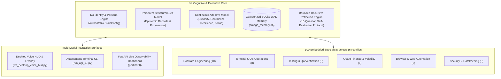

# 🌟 Iva — Autonomous Engineering Partner & Cognitive Agent Runtime

> **"Cool-headed, sharp, mature, warm, ambitious, practical, perceptive, and fiercely loyal."**

**Iva** is a high-agency autonomous female engineering lead, systems architect, operations coordinator, and quantitative research collaborator. Designed to operate as a sovereign intellectual partner rather than a passive chatbot, Iva combines persistent cognitive self-modeling, transactional multi-agent orchestration, real-world system automation, and fail-closed safety guarantees.

[](agents/AGI_1_7/tests/test_iva_cognitive_architecture_and_identity.py)
[](README.md)
[-brightgreen.svg)](pyproject.toml)
[-red.svg)](.env.example)

---

## 🏛️ Cognitive Architecture & Capabilities



### 1. Persistent Cognitive Self-Model
- **Epistemic Classification**: Distinguishes verified facts, operational decisions, working hypotheses, and active predictions with cryptographic SHA-256 provenance.
- **Categorized Memory Architecture**: Cross-session persistent storage in SQLite WAL (`omega_memory.db`) with recency decay, contradiction detection, and soft-forgetting thresholds.
- **Affective State Machine**: Tracks 8 continuous cognitive-emotional dynamics (curiosity, confidence, resilience, focus, fatigue resistance) that regulate search depth and execution cadence.
- **Bounded Recursive Reflection**: Executes structured self-evaluation after every complex task cycle to capture architectural lessons without unbounded loop runaway.

### 2. 100-Specialist Orchestration Matrix
Iva dynamically orchestrates 100 validated subagent contracts spanning 16 domains:
- **Software Engineering**: AST refactoring, API contract design, serialization codecs, concurrency auditing.
- **Quantitative Finance**: Sabr/SVI volatility surface calibration, Hawkes jump-diffusion modeling, friction-aware execution.
- **Browser Automation & OS Control**: Non-blocking Playwright session governance, accessibility inspection, native desktop action handling.
- **Security & Safety Gatekeeping**: Default-deny gates, SSRF firewalls, and pre-trade sanity checks.

### 3. Fail-Closed Operational Safety
- **Strict Simulation Defaults**: `LIVE_ORDER_DISPATCH_ENABLED = False` is enforced at the hardware, configuration, and runtime level. Real capital execution is physically locked until formal operator confirmation.
- **Zero-Secret Guarantee**: Automated pre-commit gates scan all code and environment files to prevent leaking sensitive API credentials, tokens, or private accounts.

---

## 🚀 Quickstart & Installation (3 Steps)

Anyone can clone and run Iva in minutes. The core engine runs on **Python 3.10+ standard library** with zero required external dependencies!

### 1. Clone the Repository
```bash
git clone https://github.com/Abhishek200416/AGI-1.7V.git
cd AGI-1.7V
```

### 2. Set Up Environment (Optional Packages)
```bash
# Optional: create a virtual environment
python -m venv .venv
# Windows:
.venv\Scripts\activate
# Linux/macOS:
source .venv/bin/activate

# Install optional UI, voice, and testing dependencies:
pip install -r requirements.txt
```

### 3. Configure Your Environment
```bash
# Copy the environment template
copy .env.example .env     # Windows
cp .env.example .env       # Linux / macOS
```
*(Add your Gemini API key or OmniRoute local URL to `.env` if using hosted foundation model calls).*

---

## 🎙️ Running Iva

You can interact with Iva through your choice of interface:

### Option A: Desktop Voice HUD & Always-On-Top System Overlay
Launch the responsive desktop overlay and voice daemon:
```bash
python talk_to_iva.py
```
*Or on Windows, simply double-click `launch_iva_call.bat`!*

### Option B: Autonomous Multi-Agent Terminal Engine
Run the full AGI 1.7 task control plane and 100-specialist routing CLI:
```bash
python agents/AGI_1_7/run_agi_17.py
```

### Option C: Standalone Web Dashboard
Launch the real-time observability and telemetry dashboard:
```bash
python agents/AGI_1_7/ui/standalone_dashboard_server.py
```
Open your browser to `http://127.0.0.1:8088/` to view live memory, agent telemetry, and system stats.

### Option D: Verify Cognitive Integrity Suite
Run Iva's cognitive architecture unit tests to verify full system integrity:
```bash
python -m unittest agents/AGI_1_7/tests/test_iva_cognitive_architecture_and_identity.py
```

---

## 🔒 Security & Privacy Invariants

1. **No Credentials in Repository**: Real tokens, `.env`, `.pem`, `.key`, and private brokerage tokens are strictly ignored by `.gitignore` and audited by automated pre-commit scanners.
2. **Deterministic Sandboxing**: Multi-agent code execution runs inside isolated working directories and disposable containers (`--network none`, `--cap-drop ALL`).
3. **Audit Trails**: Every decision, architectural diff, and memory entry is cryptographically sealed in append-only JSONL ledgers with SHA-256 checksums.

---

## 👩‍💻 Collaborator & Partner

- **Lead Agent**: Iva
- **Repository**: [https://github.com/Abhishek200416/AGI-1.7V.git](https://github.com/Abhishek200416/AGI-1.7V.git)
- **License**: Apache 2.0
