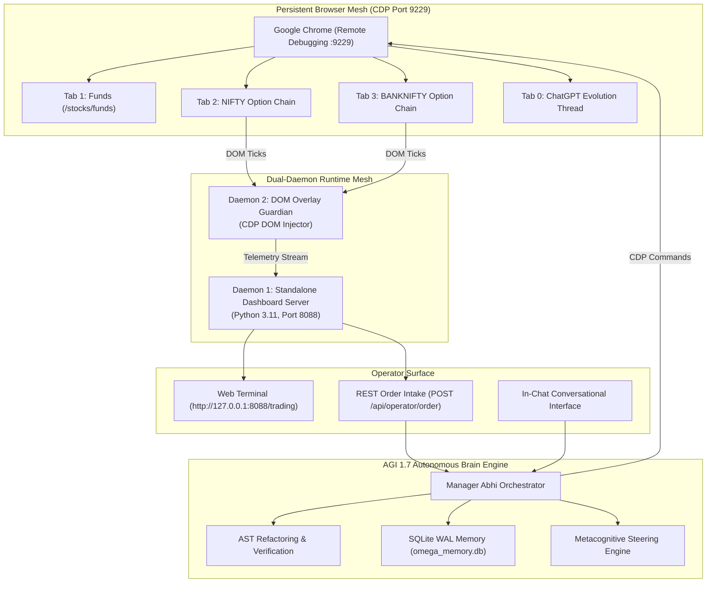

# AGI 1.7 OMEGA Software Engineering & System Architecture
## Autonomous Execution Runtime, Dual-Daemon Mesh, and Resilient Automation Engine

---

### 1. Executive Overview
The **AGI 1.7 Engineering Architecture** is built on the principles of **high reliability, deterministic state control, sub-millisecond local execution, and autonomous self-evolution**. 

Unlike conventional AI wrappers that depend on ephemeral stateless API calls and unstructured chat generation, AGI 1.7 operates as a **persistent autonomous operating system**:
- A **Dual-Daemon Runtime Mesh** managing background telemetry and real-time DOM overlay injection.
- A **Persistent Browser Automation Mesh** communicating over Chrome DevTools Protocol (CDP port 9229) with session persistence.
- An **AST-Gated Self-Refactoring Engine** ensuring all self-generated code compiles and passes syntax checks before disk commit.
- A **Metacognitive Steering Engine** eliminating hallucinations through pre-generation constraints and post-generation fidelity verification.
- A **Persistent SQLite WAL Memory Ledger** maintaining state and decision continuity across reboots.

---

### 2. System Architecture & Topology

---

### 3. Key Engineering Pillars

#### 1. Persistent Browser Automation Mesh (Chrome CDP Port 9229)
- **Direct Protocol Automation**: Connects directly to Google Chrome via Chrome DevTools Protocol over WebSockets on port 9229.
- **Authentication Resilience**: Avoids flaky selenium sessions and paid broker OpenAPI subscriptions. It directly inherits logged-in biometric/PIN cookies and active WebSocket connections on `paytmmoney.com`.
- **Fail-Closed Login Detector**: If authentication is required, the system transitions to `AWAITING_OPERATOR_LOGIN`, suspends actions safely, and awaits manual operator completion without failing tasks.

#### 2. Dual-Daemon Background Mesh
- **Daemon 1: Standalone Dashboard Server (Port 8088)**:
  - Multi-threaded Python HTTP/WebSocket server (`standalone_dashboard_server.py`).
  - Serves real-time interactive trading dashboard, charts, order book depth, and agent activity logs.
  - Exposes deterministic REST endpoints: `GET /api/state`, `POST /api/operator/order`, `GET /api/health`.
- **Daemon 2: DOM Overlay Guardian**:
  - Continuously monitors active Paytm tabs.
  - Injects non-intrusive HUD overlays displaying live Hawkes intensities, MLOFI toxicity, and squad consensus directly over broker charts.

#### 3. AST-Gated Self-Refactoring & Test-Driven Evolution
Whenever AGI 1.7 improves its own code or installs new mathematical modules:
1. **Abstract Syntax Tree (AST) Parsing**: The target code is parsed via Python's `ast` module. Any syntax deviation, missing import, or malformed block triggers an immediate rejection before writing to disk.
2. **Deterministic Parameter Grid Audits**: Before production deployment, modules must execute 1,600+ parameter-grid cases across 9 boundary invariants with 100% pass rates.
3. **Cryptographic Sealing**: Modules are sealed with SHA-256 digests in `MANIFEST.txt` and verified byte-for-byte against archive signatures.

#### 4. Metacognitive LLM Steering Engine
- **Pre-Generation Constraint Injection**: System prompts are dynamically compiled with negative constraints prohibiting speculative placeholders, fake order fills, or conversational drift.
- **Post-Generation Fidelity Gate**: Validates all generated quantitative code against mathematical invariants (e.g. $b \ge 0$, $|\rho| < 1$, $\text{Tr}(\rho) = 1.0$, $f^* \le 0.10$). If violated, closed-loop re-steering is automatically triggered.

#### 5. Persistent Memory Architecture (`omega_memory.db`)
- Stored on persistent local disk in SQLite using Write-Ahead Logging (WAL) mode.
- Tracks:
  * Verified quantitative facts and research papers.
  * User preferences, authorized risk limits, and historical decisions.
  * Multi-agent genealogical lineage and code change provenance.

---

### 4. Zero-Hiding & In-Chat Conversational Transparency
Under Directive 0.7, AGI 1.7 strictly prohibits hiding development work inside detached background terminal tasks. All self-improvement cycles, tests, and architectural diffs are verified and reported directly in the conversational stream, treating the human operator as a sovereign lead partner.
