# AGI 1.7 OMEGA Specialist Squad Catalog
## 106-Agent Institutional Specialist Hierarchy, Squad Activation Dynamics, and Governance Protocols

---

### 1. Executive Architecture & Mission
The **AGI 1.7 Specialist Hierarchy** is an institutional multi-agent collective comprising **106 registered specialist roles across 16 core scientific and engineering families**, coordinated by **Manager Abhi**.

Rather than relying on a single monolithic generalist prompt, AGI 1.7 decomposes complex autonomous engineering, research, and financial tasks across specialized domain experts with dedicated mathematical invariants, evaluation contracts, and bounded permissions.

---

### 2. The 16-Family Specialist Hierarchy (106 Roles)

```mermaid
graph TD
    Manager["Manager Abhi (Lead Coordinator & Live Veto)"] --> F1["1. Planning & Architecture (6)"]
    Manager --> F2["2. Research & Synthesis (8)"]
    Manager --> F3["3. Mathematics & Symbolic (6)"]
    Manager --> F4["4. Physics & Physical Sciences (6)"]
    Manager --> F5["5. Chemistry & Molecular (5)"]
    Manager --> F6["6. Biology & Biomedical (5)"]
    Manager --> F7["7. Software Engineering (10)"]
    Manager --> F8["8. Terminal & Shell Ops (8)"]
    Manager --> F9["9. Containers & Cloud (6)"]
    Manager --> F10["10. Browser & Web Automation (6)"]
    Manager --> F11["11. Desktop & Computer Use (6)"]
    Manager --> F12["12. Data & Storage (6)"]
    Manager --> F13["13. Testing & QA (8)"]
    Manager --> F14["14. Security & Safety (6)"]
    Manager --> F15["15. Performance & Tokens (4)"]
    Manager --> F16["16. Release & Governance (4)"]
    Manager --> TradingSquad["Dedicated Trading Squad (Alex, Emily, Max)"]
```

#### Complete Specialist Catalog:
1. **Planning & Architecture (6 roles)**:
   `plan_mission_decomposer`, `plan_systems_architect`, `plan_dependency_analyzer`, `plan_risk_estimator`, `plan_capacity_forecaster`, `plan_adr_synthesizer`.
2. **Research & Evidence Synthesis (8 roles)**:
   `res_primary_source_hunter`, `res_citation_auditor`, `res_contradiction_detector`, `res_freshness_assessor`, `res_sdk_doc_navigator`, `res_benchmark_methodology_analyst`, `res_patent_and_standard_reviewer`, `res_evidence_ledger_archivist`.
3. **Mathematics & Symbolic Reasoning (6 roles)**:
   `math_algebraic_solver`, `math_combinatorics_analyst`, `math_probability_statistician`, `math_linear_algebra_verifier`, `math_number_theory_checker`, `math_real_complex_analyst`.
4. **Physics & Physical Sciences (6 roles)**:
   `phys_quantum_mechanics_reasoner`, `phys_relativistic_electrodynamics`, `phys_statistical_thermodynamics`, `phys_astrophysics_cosmology`, `phys_condensed_matter_analyst`, `phys_dimensional_consistency_auditor`.
5. **Chemistry & Molecular Sciences (5 roles)**:
   `chem_organic_synthesis_planner`, `chem_spectroscopy_elucidator`, `chem_kinetics_thermochemistry`, `chem_inorganic_coordination`, `chem_quantum_molecular_orbital`.
6. **Biology & Biomedical Sciences (5 roles)**:
   `bio_molecular_genetics_reasoner`, `bio_cell_signaling_oncology`, `bio_biochemistry_enzymology`, `bio_immunology_virology`, `bio_bioinformatics_sequence_analyst`.
7. **Software Engineering (10 roles)**:
   `swe_python_runtime_engineer`, `swe_ast_refactoring_specialist`, `swe_api_contract_designer`, `swe_concurrency_lock_auditor`, `swe_exception_resilience_engineer`, `swe_cli_ux_engineer`, `swe_serialization_codec_specialist`, `swe_dependency_hygiene_auditor`, `swe_state_machine_implementer`, `swe_patch_minimizer`.
8. **Terminal, Shell & OS Operations (8 roles)**:
   `ops_powershell_automation_specialist`, `ops_posix_shell_specialist`, `ops_process_tree_warden`, `ops_filesystem_storage_steward`, `ops_stream_progress_monitor`, `ops_archive_artifact_verifier`, `ops_environment_isolation_guard`, `ops_git_worktree_custodian`.
9. **Containers, Virtualization & Cloud (6 roles)**:
   `virt_docker_engine_inspector`, `virt_wsl2_memory_governor`, `virt_harbor_sandbox_coordinator`, `virt_dockerfile_layer_optimizer`, `virt_vm_image_readiness_auditor`, `virt_container_network_isolation_checker`.
10. **Browser & Web Automation (6 roles)**:
    `web_playwright_session_controller`, `web_dom_accessibility_inspector`, `web_network_har_analyzer`, `web_form_workflow_automator`, `web_ssrf_robots_compliance_guard`, `web_visual_regression_verifier`.
11. **Desktop & Computer Use (6 roles)**:
    `desk_sandbox_isolation_enforcer`, `desk_osworld_task_inspector`, `desk_screenshot_observation_compressor`, `desk_gui_action_schema_validator`, `desk_vm_snapshot_coordinator`, `desk_multi_app_handoff_planner`.
12. **Data, Storage & Databases (6 roles)**:
    `data_sqlite_wal_architect`, `data_jsonl_ledger_reconciler`, `data_memory_supersession_curator`, `data_acon_context_compressor`, `data_checkpoint_recovery_steward`, `data_telemetry_schema_normalizer`.
13. **Testing, QA & Verification (8 roles)**:
    `qa_unit_suite_runner`, `qa_integration_scenario_verifier`, `qa_gpqa_clean_auditor`, `qa_terminal_bench_reconciler`, `qa_claim_to_evidence_verifier`, `qa_registry_smoke_harness`, `qa_state_transition_fuzzer`, `qa_regression_baseline_comparator`.
14. **Security, Permissions & Safety (6 roles)**:
    `sec_permission_gate_enforcer`, `sec_prompt_injection_shield`, `sec_secret_credential_scanner`, `sec_benchmark_integrity_warden`, `sec_ssrf_network_firewall`, `sec_directive_zero_auditor`.
15. **Performance, Token & Resource Optimization (4 roles)**:
    `perf_adaptive_concurrency_governor`, `perf_token_budget_controller`, `perf_tail_latency_mitigator`, `perf_quantum_claim_gatekeeper`.
16. **Release, Governance & Reporting (4 roles)**:
    `gov_manifest_hash_sealer`, `gov_telemetry_dashboard_publisher`, `gov_phase_gate_reviewer`, `gov_release_dossier_compiler`.

---

### 3. The Dedicated Quantitative Trading Squad

While the 16 scientific families support broad systems development, quantitative trading execution is managed by a dedicated 4-agent committee:

1. **Manager Abhi (Sole Operator Intake Liaison & Live Veto)**:
   - **The ONLY agent authorized to take orders directly from the human operator.**
   - Manages capital distribution, risk limits, and holds binding live veto power over dispatch.
2. **Alex (Microstructure & L3 Queue Specialist)**:
   - Formulates micro-price drift from top-5 level MLOFI and tracks Hawkes jump bursts.
   - Triggers quote retreat (`RETREAT`) during toxic adverse selection.
3. **Emily (Rough Volatility & News Sentiment Specialist)**:
   - Computes fractional Volterra skews and relative-value smile mispricing.
   - Evaluates macroeconomic headlines and conditions expected market volatility.
4. **Max (Risk Management & Indian Statutory Cost Specialist)**:
   - Models 100% of Indian exchange charges (brokerage, STT, NSE, GST, SEBI).
   - Enforces Bayesian-Kelly position ceilings ($f^* \le 10\%$) and daily loss stops.

---

### 4. State Dynamics: 2 Executing Daemons vs. 104 Standby Agents

On the live dashboard (`/agents`), the operator observes:
- **Total Registered Roles**: 106 Agents
- **Actively Executing**: 2 Agents (`standalone_dashboard_daemon`, `overlay_guardian_daemon`)
- **Idle / Standby**: 104 Agents

#### Why This Architecture is Intentional:
1. **Zero CPU & Token Exhaustion**:
   If all 106 agents were in a continuous busy-loop, host CPU usage would peg at 100% and hundreds of thousands of LLM tokens would be wasted while the market is closed.
2. **Persistent Background Daemons (The 2 Executing)**:
   - `standalone_dashboard_daemon`: Runs the asynchronous HTTP server on port 8088.
   - `overlay_guardian_daemon`: Monitors Chrome CDP 9229 and keeps DOM HUD overlays responsive.
3. **Event-Driven & Timer-Woken Specialists (The 104 Standby)**:
   The remaining specialists are triggered solely on demand:
   - **Market Ticks**: When options depth updates arrive, Alex and Emily wake to recalculate MLOFI and volatility skews.
   - **Timer Countdown**: At 09:00 AM IST, the macro news agent wakes to ingest global market data.
   - **Operator Order Submission**: When the operator clicks an order, Manager Abhi wakes the squad to evaluate consensus.
   - Once the computation finishes, the agent records its output in memory and returns cleanly to `STANDBY`.

---

### 5. Skill Quarantining & Token Budget Optimization
To eliminate context bloat and preserve up to **20,000 tokens per turn**:
- Active skills are strictly budgeted: only 47 essential trading, browser automation, and quantitative skills are active in `.agents\skills`.
- The remaining 1,976 inactive or auxiliary skills are safely archived in `.agents\skills_vault`, guaranteeing clean, fast model inference without distracting prompt clutter.
