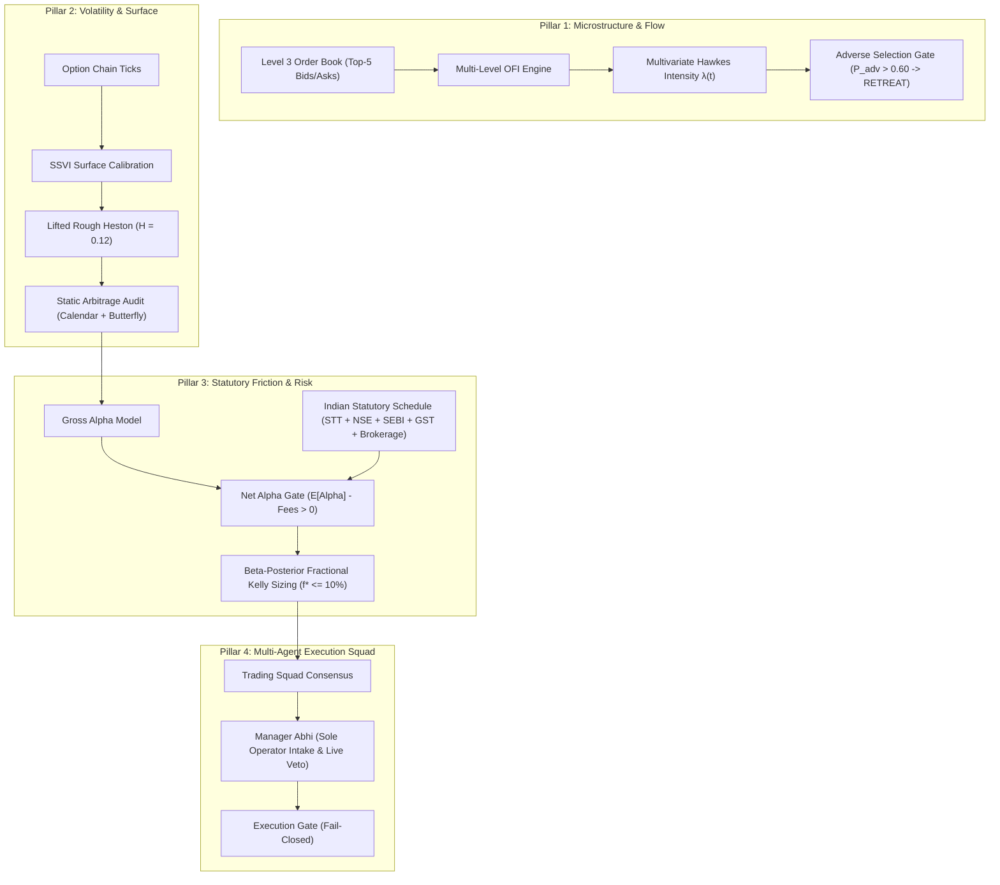

# AGI 1.7 OMEGA Quantitative Trading Architecture
## Autonomous Systematic Derivatives Engineering for Indian Indices (NIFTY 50 & BANKNIFTY)

---

### 1. Executive Summary & Core Mission
The **AGI 1.7 OMEGA Quantitative Trading System** is an institutional-grade, mathematically verified, friction-aware quantitative execution and volatility arbitrage engine designed specifically for Indian index options (`NIFTY 50` and `BANKNIFTY`).

Unlike conventional algorithmic retail bots that rely on lagging technical indicators (RSI, MACD, moving averages) or black-box heuristic rules, AGI 1.7 operates across continuous mathematical foundations:
- **Multivariate point processes (Hawkes self- and cross-excitation)** to detect toxic order flow and adverse selection.
- **Microstructure order flow imbalance (Level 3 depth-weighted MLOFI)** to forecast micro-price drift before quotes shift.
- **Rough volatility modeling (fractional Volterra neural SDEs, Lifted Rough Heston, SABR/SSVI)** to exploit option skew and surface mispricing.
- **Friction-first execution theory**, enforcing exact Indian statutory deductions (STT, NSE turnover charges, SEBI fees, stamp duty, flat brokerage, and GST) before any trade can be admitted.
- **Strict fail-closed safety gates** (`LIVE_ORDER_DISPATCH_ENABLED = False`) preventing live capital deployment without explicit cryptographic authorization and verified available cash.

---

### 2. Theoretical Pillars of the Quantitative Engine



#### Pillar 1: High-Frequency Microstructure Intelligence
1. **Multi-Level Order Flow Imbalance ($\text{MLOFI}_t$)**:
   Extracts directional pressure across the top 5 levels of the limit order book:
   $$\text{MLOFI}_t = \sum_{l=1}^5 w_l \left(\Delta V_t^b(l) \mathbf{1}_{\Delta P_t^b(l) \ge 0} - \Delta V_t^a(l) \mathbf{1}_{\Delta P_t^a(l) \le 0}\right)$$
   where $w_l = [1.0, 0.8, 0.6, 0.4, 0.2]$ linearly discounts deeper book levels.
2. **Coupled Hawkes Jump Intensity with Power-Law Decays**:
   $$\lambda_i(t) = \mu_i + \gamma_{\text{MLOFI}} |\text{MLOFI}_t|^\beta + \sum_{j=1}^d \sum_{t_n^{(j)} < t} \alpha_{ij} e^{-\beta_{ij} (t - t_n^{(j)})}$$
   Identifies self-excitation (cascading stop runs) and mutual cross-excitation between NIFTY 50 and BANKNIFTY.
3. **Adverse Selection Toxicity Retreat Gate**:
   Real-time adverse selection hazard probability:
   $$P_{\text{adv}} = 1 - e^{-\lambda(t) \tau}$$
   When $P_{\text{adv}} > 0.60$, the system pulls passive quotes (`RETREAT`), avoiding toxic market orders from informed institutional desks.

#### Pillar 2: Rough Volatility & Surface Arbitrage
1. **Lifted Rough Heston Volterra SDE ($H \approx 0.12$)**:
   Replaces non-stationary standard Brownian volatility with singular fractional kernels $K(t - s) = \frac{(t - s)^{H - 1/2}}{\Gamma(H + 1/2)}$. Implements Markovian multi-factor exponential lifting to ensure sub-millisecond calibration without latency.
2. **Static & Dynamic Arbitrage Audits**:
   - **Calendar Monotonicity**: $\frac{\partial w(k, T)}{\partial T} \ge 0$ (total implied variance non-decreasing in expiry).
   - **Butterfly Convexity**: $g(k) = \left(1 - \frac{k w'(k)}{2 w(k)}\right)^2 - \frac{w'(k)^2}{4}\left(\frac{1}{w(k)} + \frac{1}{4}\right) + \frac{w''(k)}{2} > 0$ strictly verified across discrete strikes.
3. **Relative-Value Cross-Surface Dispersion**:
   Monitors implied volatility spreads between NIFTY 50 and BANKNIFTY, taking mean-reverting dispersion positions only when mispricing exceeds total friction.

#### Pillar 3: Friction-Aware Net Alpha Optimization
Trading without statutory transaction cost modeling is a pure financial illusion. AGI 1.7 deducts 100% of Indian exchange and statutory costs on every simulated or live execution:
- **Brokerage**: Flat ₹20 per executed order (₹40 round-trip).
- **Securities Transaction Tax (STT)**: 0.15% on option sell turnover.
- **Exchange Turnover Fee (NSE)**: 0.03553% on premium turnover.
- **Goods and Services Tax (GST)**: 18% on (Brokerage + Exchange Turnover Charges).
- **SEBI Regulatory Fee**: 0.0001% (₹10 per crore).
- **Stamp Duty**: 0.003% on buy turnover.

**The Net Alpha Gate Invariant**:
$$\mathbb{E}[\text{Gross Alpha}] - \text{Total Statutory Fees} > 0$$
On a 50-qty NIFTY lot, round-trip friction is ~₹53. A 1-point move generates ₹50 gross, resulting in a net loss. Therefore, AGI 1.7 enforces a minimum edge hurdle of **≥ 2.5 to 3.0 index points (₹125 to ₹150 gross gain per lot)** before admitting any order.

#### Pillar 4: Beta-Posterior Fractional Kelly Sizing
Positions are sized via a Bayesian-updated Kelly criterion:
$$f^* = \frac{p \cdot b - (1 - p)}{b}$$
- Win probability $p$ is continuously updated via a $\text{Beta}(\alpha, \beta)$ posterior distribution.
- **Safety Ceiling**: Capped at a conservative maximum 10% capital fraction ($f^* \le 0.10$). Zero reckless all-in allocations.

---

### 3. The 4-Agent Trading Squad Hierarchy

```mermaid
flowchart TD
    User["Human Operator (Orders & Directives)"] -->|POST /api/operator/order| Abhi["Manager Abhi<br/>(Sole Intake & Capital Governance)"]
    Abhi -->|Audit Request| Alex["Alex<br/>(Microstructure & L3 MLOFI)"]
    Abhi -->|Audit Request| Emily["Emily<br/>(Rough Volatility & News Sentiment)"]
    Abhi -->|Audit Request| Max["Max<br/>(RMS & Statutory Friction)"]

    Alex -->|Hawkes Toxicity & Spread| Consensus["Squad Consensus Engine"]
    Emily -->|Smile Skew & Mispricing| Consensus
    Max -->|Fee Check & Kelly Cap| Consensus

    Consensus -->|Unanimous Affirmative| Abhi
    Abhi -->|Binding Live Veto| Gate{"Fail-Closed Live Gate<br/>LIVE_ORDER_DISPATCH_ENABLED"}
    Gate -->|False (Default)| Paper["Simulated Fill (epoch_10k)"]
    Gate -->|True (Explicit Sign-off)| Broker["Live Broker Dispatch (Paytm Money)"]
```

1. **Manager Abhi (Sole Operator Intake Liaison & Live Veto)**:
   - **The ONLY agent authorized to take orders directly from the human operator.**
   - Holds supreme binding veto power over live dispatch and capital allocation.
   - Arbitrates specialist evaluations and enforces fail-closed state.
2. **Alex (L3 Microstructure & Order Flow Specialist)**:
   - Tracks 5-level depth changes, MLOFI, and Hawkes queue depletion.
   - Issues forced quote retreats (`RETREAT`) during toxicity bursts.
3. **Emily (Rough Volatility & News Sentiment Specialist)**:
   - Evaluates Riemann-Liouville fractional variance, SABR/SSVI smiles, and calendar spreads.
   - Conditions volatility expectations on real-time macroeconomic news shocks.
4. **Max (Risk Management & Statutory Cost Specialist)**:
   - Enforces the 100% Indian statutory fee schedule.
   - Computes Bayesian-Kelly position limits and checks daily loss ceilings.

---

### 4. Daily Operational Lifecycle & Market Timing

| Time Window (IST) | Market Phase | System Actions & Invariants |
| :--- | :--- | :--- |
| **09:00 – 09:08 AM** | **Pre-Market Discovery** | Ingest overnight global macro data (US closes, crude oil, Gift Nifty); compute opening volatility skews; build **Watchlist**. **Strict Invariant**: Zero blind market orders. |
| **09:08 – 09:15 AM** | **Order Matching Buffer** | Calculate equilibrium opening prices; calibrate expected initial spread. |
| **09:15 – 09:20 AM** | **Market Open Volatility Spike** | Monitor opening Hawkes jump clustering; keep quotes retreated while bid-ask spreads normalize. |
| **09:20 – 15:15 PM** | **Continuous Systematic Execution** | Active microstructure tracking; enter single-lot NTM/OTM options only when Net Alpha Gate verifies $\mathbb{E}[\text{Alpha}] > \text{Fees}$. |
| **15:15 – 15:30 PM** | **Terminal Liquidation** | Strict intraday zero-inventory invariant ($q(T) = 0.0$); liquidate all open positions before 15:15 IST. Zero overnight gap risk. |

---

### 5. Why AGI 1.7 is Superior to Standard Trading Systems

1. **Zero Illusion Accounting**:
   Commercial bots ignore statutory friction, claiming high paper returns that vanish in real trading. AGI 1.7 includes 100% of Indian statutory taxes and charges in every single optimization step.
2. **Microstructure-Driven Defense**:
   Retail bots get caught in stop-loss hunts. AGI 1.7 uses Hawkes processes and MLOFI to detect toxic institutional flow and retreat before adverse fills occur.
3. **Continuous 24/7 Autonomous Self-Evolution**:
   AGI 1.7 never stops learning. It continuously harvests cutting-edge quantitative literature, extracts mathematical kernels, runs parameter-grid tests (1,600+ cases), verifies SHA-256 cryptographic digests, and integrates verified upgrades autonomously.
4. **Fail-Closed Architectural Safety**:
   Live execution is impossible without positive balance, completed operator authentication, and unanimous squad consensus under Manager Abhi's direct supervision.
