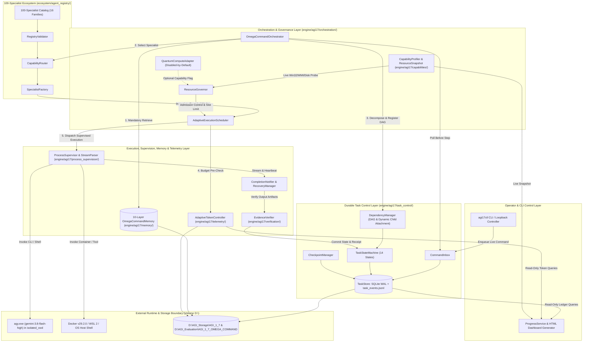
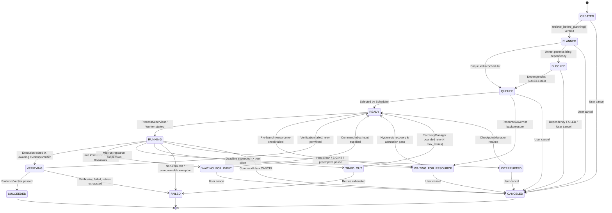

# AGI 1.7 — OMEGA COMMAND: System Architecture Specification

**Document ID:** `ARCH-SPEC-AGI17-20261010`  
**Codename:** `AGI 1.7 — OMEGA COMMAND`  
**Version:** `1.7.0`  
**Status:** `APPROVED / AUTHORITATIVE SPECIFICATION`  
**Timestamp:** `2026-10-10T18:18:00+05:30` (`2026-10-10T12:48:00Z`)  
**Repository Root:** `<REPO_ROOT>`  
**Codebase Root:** `<REPO_ROOT>\agents\AGI_1_7\`  
**Primary External Storage Roots:**  
- `D:\AGI_Storage\AGI_1_7\` (SQLite WAL ledgers, 10-layer persistent memory, checkpoints, process registries)  
- `D:\AGI_Evaluation\AGI_1_7_OMEGA_COMMAND\` (Isolated benchmark CWD, raw telemetry JSONL, campaign artifacts)  
**Sole Foundation Model (Directive 0):** `gemini-3.8-flash-high` via Antigravity CLI (`agy.exe` v1.3.3)

---

## 1. Executive Summary & Architectural Invariants

**AGI 1.7 — OMEGA COMMAND** is a ground-up architectural remediation and capability upgrade over AGI 1.5 and AGI 1.6 (`OMEGA NEXUS`). Source-level forensic inspection of AGI 1.6 (`docs/AGI_1_7_BASELINE_AUDIT.md`) proved 10 structural defects, including stubbed in-memory worker execution, missing live instruction intake, orphaned subprocess execution, unintegrated memory retrieval, unvalidated specialist roles, hardcoded dashboard numbers, and a **22,700-token per-turn workspace context leak** caused by invoking `agy.exe` inside the repository root without an isolated working directory.

AGI 1.7 resolves every baseline defect through **seven non-negotiable system invariants**:

1. **Directive 0 Model Exclusivity:** All LLM reasoning routes exclusively through `gemini-3.8-flash-high` via `agy.exe` (`--output-format json` and `--output-format stream-json`). No silent fallback to unauthenticated or synthetic mock generators is permitted in production or benchmark paths.
2. **Strict Separation of Catalog, Graph, and Execution Concurrency:**
   - `MAX_AGENT_SPECIALIZATIONS = 100` (validated specialist contracts in `ecosystem/agent_registry/`).
   - `MAX_LOGICAL_CHILD_TASKS = 100` (maximum logical child nodes per parent job in the persistent DAG).
   - `MAX_ACTIVE_EXECUTIONS = dynamic (1..4)` (live physical concurrency governed continuously by `ResourceGovernor` based on measured CPU, physical RAM, commit charge, disk headroom, and API quota).
3. **Storage Quarantine & External-Drive Persistence:** `C:\` (`13.49 GB` free) is strictly quarantined from benchmark outputs, checkpoints, and large logs. All runtime persistence and benchmark execution outputs reside on `D:\` (`610.82 GB` free, verified via SHA-256 probe `dde15ffe684a0d4c3e8677dbed56432788cc11da5cdc1ca6ff704f1a9ea2fadb`).
4. **Workspace Context Isolation for Closed-Book Calls:** Closed-book reasoning and benchmark invocations execute inside `D:\AGI_Evaluation\AGI_1_7_OMEGA_COMMAND\isolated_cwd` (an empty directory containing zero repository rules, skills, or `.git` metadata), reducing Turn-1 prompt overhead from `~22,700` tokens to `~2,250` tokens (`~90.1%` reduction).
5. **Transactional Durability & Live Steerability:** Task state, parent-child lineage, and live operator instructions are persisted in a transactional SQLite Write-Ahead Logging (`WAL`) database backed by an append-only JSONL event stream (`task_events.jsonl`), polled at every step boundary via `CommandInbox`.
6. **Mandatory Memory Retrieval Before Planning:** The orchestrator cannot transition a task from `CREATED` to `PLANNED` without executing `OmegaCommandMemory.retrieve_before_planning()` and recording a cryptographic `MemoryRetrievalReceipt` in the task ledger.
7. **Zero-Hardcode Telemetry & Evidence Verification:** Every dashboard card, report table, and completion state is derived strictly from SQLite/JSONL ledgers and verified artifacts (`EvidenceVerifier`). Unmeasured metrics must be explicitly marked `UNAVAILABLE` or `UNKNOWN`.

---

## 2. Architecture Decision Records (ADRs)

### ADR-001: Decoupling Specialist Catalog Size, Logical DAG Fan-Out, and Active Worker Concurrency
- **Context:** In AGI 1.6, specialist count (`76`), DAG task lists, and `ThreadPoolExecutor(max_workers=5..16)` were conflated, resulting in `10` simultaneous `agy.exe` Node/CLI processes competing for `~2.9 GB` of available physical RAM.
- **Decision:** Define three orthogonal architectural constants and controllers:
  1. `MAX_AGENT_SPECIALIZATIONS = 100`: Static registry capacity of validated `AgentContract` definitions across 16 functional families.
  2. `MAX_LOGICAL_CHILD_TASKS = 100`: Maximum logical tasks that a parent job may decompose into within `TaskStore`.
  3. `MAX_ACTIVE_EXECUTIONS`: Dynamic integer slot ceiling computed every polling cycle by `ResourceGovernor.compute_safe_concurrency(snapshot)`. On the target host (`16,077.2 MB` total RAM, `~2,921.1 MB` available physical RAM, `5,145.5 MB` available commit), `MAX_ACTIVE_EXECUTIONS` dynamically clamps between `1` and `4` for heavy LLM/container tasks.
- **Consequences:** Enables rich 100-task decomposition and 100-role specialization while preventing host OOM, swap thrashing, and CLI subprocess starvation.

### ADR-002: Hybrid SQLite WAL + Append-Only JSONL Event Sourcing for Task Control
- **Context:** AGI 1.6 stored task nodes and `AgentMessageBus` messages in ephemeral Python lists, losing all state on interruption and ignoring mid-run instructions.
- **Decision:** Implement `engine/agi17/task_control/` using a dual-storage engine on `D:\AGI_Storage\AGI_1_7\task_control\`:
  - `omega_task_store.sqlite3` (`PRAGMA journal_mode=WAL; PRAGMA synchronous=NORMAL; PRAGMA foreign_keys=ON;`) for ACID state transitions, parent-child foreign keys, active PID registration, and `command_inbox` polling.
  - `task_events.jsonl` for immutable, append-only chronological audit logging of every state transition, checkpoint, and inbox command.
- **Consequences:** Sub-millisecond indexed queries for live orchestration and `agi17ctl`, combined with human-auditable JSONL provenance and deterministic crash recovery.

### ADR-003: Mandatory Isolated Working Directory (`isolated_cwd`) for Closed-Book Model Execution
- **Context:** Forensic analysis of `gpqa_clean_189_task_results.jsonl` proved that omitting `AGI_ISOLATED_CWD` in `scripts/execute_benchmark_campaign.py` caused `agy.exe` to load the entire workspace context (`~22,700` tokens on Turn 1) and trigger multi-turn tool loops averaging `39,105` input tokens per question (`7,390,798` total input tokens across 189 questions).
- **Decision:** `AdaptiveTokenController` and `ModelExecutionAdapter` enforce `cwd = D:\AGI_Evaluation\AGI_1_7_OMEGA_COMMAND\isolated_cwd` for all `CLOSED_BOOK_REASONING` and benchmark tasks, paired with explicit single-turn non-tool system instructions.
- **Consequences:** Eliminates workspace context leakage, restores `~2,200–2,400` input tokens per GPQA question, and cuts subprocess execution time from `127.6s` mean to `~25–40s`.

### ADR-004: Non-Blocking Streaming Process Supervision with Guaranteed Parent Notification
- **Context:** AGI 1.6 used blocking `subprocess.run`, leaving parent tasks uninformed when background jobs or Harbor trials finished or timed out.
- **Decision:** Replace blocking calls with `ProcessSupervisor` (`subprocess.Popen` + asynchronous reader threads `StreamParser` + `CompletionNotifier`). Every spawned child PID is registered in `TaskStore` before execution, emits periodic heartbeats, and upon exit triggers `CompletionNotifier.notify_parent(event)` within the same transaction that marks the child terminal. On timeout or cancellation, Windows process trees are terminated cleanly via `taskkill /F /T /PID <pid>`.
- **Consequences:** Zero zombie subprocesses, real-time stdout/stderr streaming, and 100% deterministic parent wakeup upon child completion.

### ADR-005: 10-Layer SQLite+WAL Memory with Fact Supersession & Mandatory Pre-Planning Retrieval
- **Context:** AGI 1.6 never called `memory.retrieve()` during task execution and appended conflicting facts without versioning.
- **Decision:** Upgrade to a 10-layer SQLite-backed memory engine (`OmegaCommandMemory`) featuring:
  1. `retrieve_before_planning(task_id, query, domains)` returning a `MemoryRetrievalReceipt` required by `TaskStateMachine` to enter `PLANNED`.
  2. Versioned fact keys with `supersedes_id`, `version`, and `is_active` flags so updated facts supersede stale facts while retaining full historical lineage in `fact_audit_history`.
  3. ACON-inspired deterministic context compression that compacts verbose tool logs while strictly preserving exact identifiers, SHA-256 hashes, file paths, exit codes, and error tracebacks.
- **Consequences:** Cross-session continuity is enforced by construction, stale facts never pollute prompts, and audit trails remain intact.

---

## 3. System Component Interaction & Acyclic Dependency Architecture

### 3.1 High-Level Component Interaction Diagram



### 3.2 Acyclic Package Dependency Hierarchy (`agents/AGI_1_7/`)

To guarantee zero circular imports, module dependencies follow a strict bottom-up Directed Acyclic Graph (DAG) across 6 strata:

- **Stratum 0 (Foundation Types & Schemas):** `engine/agi17/schemas/` (Pure Python dataclasses/enums; imports stdlib only).
- **Stratum 1 (Hardware Probing & Persistence Primitives):**
  - `engine/agi17/capabilities/` (`CapabilityProfiler`, `ResourceSnapshot` — depends on Stratum 0).
  - `engine/agi17/memory/` (`OmegaCommandMemory`, `AconCompressor` — depends on Stratum 0).
  - `engine/agi17/verification/` (`EvidenceVerifier` — depends on Stratum 0).
- **Stratum 2 (Telemetry & Durable Task Control):**
  - `engine/agi17/telemetry/token_economy.py` (`AdaptiveTokenController` — depends on Strata 0–1).
  - `engine/agi17/task_control/` (`TaskStore`, `TaskStateMachine`, `CheckpointManager`, `DependencyManager`, `CommandInbox` — depends on Strata 0–1).
- **Stratum 3 (Process Supervision & Specialist Registry):**
  - `engine/agi17/process_supervision/` (`ProcessSupervisor`, `StreamParser`, `CompletionNotifier`, `RecoveryManager` — depends on Strata 0–2).
  - `ecosystem/agent_registry/` (`AgentContract`, `RegistryValidator`, `CapabilityRouter`, `SpecialistFactory` — depends on Strata 0–2).
- **Stratum 4 (Resource Governance & Orchestration):**
  - `engine/agi17/orchestration/` (`ResourceGovernor`, `QuantumComputeAdapter`, `AdaptiveExecutionScheduler`, `OmegaCommandOrchestrator` — depends on Strata 0–3).
- **Stratum 5 (Observability, CLI & Entrypoints):**
  - `engine/agi17/telemetry/progress_service.py` (`ProgressService`, HTML Dashboard builder — depends on Strata 0–4).
  - `scripts/agi17ctl.py` and benchmark runners (depend on Strata 0–5).

---

## 4. Detailed Subsystem & Contract Specifications

### 4.1 Cardinality & Concurrency Governance Constants

Defined in [`engine/agi17/orchestration/resource_governor.py`](file:///<REPO_ROOT>/agents/AGI_1_7/engine/agi17/orchestration/resource_governor.py):

```python
MAX_AGENT_SPECIALIZATIONS: int = 100   # Total validated specialist contracts in registry
MAX_LOGICAL_CHILD_TASKS: int = 100     # Max child task nodes per parent job in DAG
MIN_ACTIVE_EXECUTIONS: int = 1         # Forward-progress floor when resources are constrained
HARD_MAX_ACTIVE_EXECUTIONS: int = 8    # Absolute ceiling on 16-logical-CPU machine
```

At runtime, `MAX_ACTIVE_EXECUTIONS` is computed dynamically per workload class:
- On the current machine (`16,077.2 MB` total RAM, `~2,921.1 MB` available physical RAM, `5,145.5 MB` available commit), `MAX_ACTIVE_EXECUTIONS` evaluates to:
  - `2` to `3` concurrent workers for `REASONING_LLM_QUEUE` (`agy.exe` in `isolated_cwd`, ~220 MB RAM each).
  - `1` to `2` concurrent workers for `CONTAINER_VM_QUEUE` (Harbor Docker trials / OSWorld VM operations, ~600–1,200 MB RAM each).
  - `4` concurrent workers for `VERIFICATION_LIGHT_QUEUE` (in-process deterministic Python/SQLite checks, <35 MB RAM each).

---

### 4.2 `CapabilityProfiler` & `ResourceSnapshot` (`engine/agi17/capabilities/`)

#### Purpose
Provides zero-mock, real-time hardware and runtime environment introspection on Windows 11 using Win32 ctypes APIs (`GlobalMemoryStatusEx`, `GetSystemTimes`, `GetDiskFreeSpaceExW`), subprocess probes (`docker info`, `wsl --status`, `agy.exe --version`), and process table scanning.

#### Interface Contract

```python
@dataclass(frozen=True)
class StorageVolumeProfile:
    mount_point: str                  # e.g., "C:\\" or "D:\\"
    total_gb: float
    free_gb: float
    used_percent: float
    quarantined_for_bulk_writes: bool # True for C:\ (13.49 GB free), False for D:\ (610.82 GB free)
    write_probe_sha256: Optional[str] # Verified digest or None if read-only/quarantined

@dataclass(frozen=True)
class ExternalProcessEntry:
    pid: int
    name: str
    cmdline: str
    rss_mb: float
    protected_external: bool          # True for preserved PIDs 20556 & 22884

@dataclass(frozen=True)
class ResourceSnapshot:
    snapshot_id: str
    timestamp_utc: str
    os_version: str                   # "Windows-11-10.0.26220-SP0"
    logical_cpus: int                 # 16
    cpu_load_percent: float           # Measured via GetSystemTimes delta (never hardcoded)
    ram_total_mb: float               # 16077.2
    ram_available_physical_mb: float  # ~2921.1 live
    ram_used_percent: float           # ~81.8% live
    commit_limit_mb: float            # 28340.5
    commit_available_mb: float        # ~5145.5 live
    gpu_name: str                     # Detected adapter name or "UNKNOWN"
    gpu_dedicated_vram_mb: Union[float, str] # Measured MB or "UNAVAILABLE"
    volumes: Dict[str, StorageVolumeProfile]
    docker_available: bool
    docker_version: str               # "29.2.0" or "UNAVAILABLE"
    wsl_memory_mb: float              # vmmemWSL RSS (~993.0 MB)
    agy_cli_version: str              # "1.3.3"
    protected_processes: List[ExternalProcessEntry]
    quantum_backend_status: str       # "UNAVAILABLE_NO_QPU_BACKEND"

class CapabilityProfiler:
    def capture_snapshot(self, verify_d_drive_write: bool = False) -> ResourceSnapshot: ...
    def get_protected_external_pids(self) -> Set[int]: ...
```

---

### 4.3 `ResourceGovernor`, `AdaptiveExecutionScheduler` & `QuantumComputeAdapter` (`engine/agi17/orchestration/`)

#### Admission Formula
For every candidate task $T$ in workload queue $Q$, `ResourceGovernor.can_admit(T, snapshot)` evaluates across all tracked resource dimensions $r \in \{\text{CPU\_PCT}, \text{RAM\_PHYS\_MB}, \text{COMMIT\_MB}, \text{DISK\_C\_GB}, \text{DISK\_D\_GB}, \text{TOKEN\_BUDGET}, \text{QUEUE\_SLOTS}\}$:

$$\forall r: \quad \text{current\_usage}(r) + \text{estimated\_new\_load}(T, r) \le \text{safe\_capacity}(r)$$

Where $\text{safe\_capacity}(r)$ enforces hard host reserve floors:
- $\text{safe\_capacity}(\text{RAM\_PHYS\_MB}) = \text{ram\_total\_mb} - 1,400\text{ MB}$ (must leave $\ge 1,400\text{ MB}$ free physical RAM after admitting $T$; for heavy workers, requires $\ge 1,800\text{ MB}$ free prior to spawn).
- $\text{safe\_capacity}(\text{COMMIT\_MB}) = \text{commit\_limit\_mb} - 2,500\text{ MB}$ (must leave $\ge 2,500\text{ MB}$ commit available).
- $\text{safe\_capacity}(\text{CPU\_PCT}) = 85.0\%$ (scale-down trigger at $88.0\%$, scale-up recovery at $\le 72.0\%$ hysteresis band).
- $\text{safe\_capacity}(\text{DISK\_C\_GB})$: Blocks any bulk task targeting `C:\` when `C:\` free space $< 15.0\text{ GB}$ (redirecting all artifacts to `D:\`).

#### Separate Workload Queues & Hysteresis
`AdaptiveExecutionScheduler` maintains 5 priority-weighted queues:
1. `CONTROL_AND_INBOX_QUEUE` (Priority 0 — immediate in-process execution, preempts scheduling loop).
2. `VERIFICATION_LIGHT_QUEUE` (Priority 1 — fast artifact/hash/AST verification).
3. `REASONING_LLM_QUEUE` (Priority 2 — `agy.exe` calls in `isolated_cwd` or repo root).
4. `TERMINAL_BUILD_QUEUE` (Priority 3 — local pytest/compiler/shell subprocesses).
5. `CONTAINER_VM_QUEUE` (Priority 4 — Docker Harbor trials, OSWorld VM operations, heavy downloads).

**Hysteresis Policy:**
- **Throttle Down (High Watermark):** If `ram_available_physical_mb < 1,500 MB` OR `commit_available_mb < 2,500 MB` OR `cpu_load_percent > 88.0%`, `MAX_ACTIVE_EXECUTIONS` immediately drops to `1`, and queued tasks transition from `READY` to `WAITING_FOR_RESOURCE`.
- **Recover Up (Low Watermark):** Concurrency is only incremented (+1 slot per 10s stabilization window) when `ram_available_physical_mb >= 2,100 MB` AND `commit_available_mb >= 3,500 MB` AND `cpu_load_percent <= 72.0%`.

#### `QuantumComputeAdapter` (Disabled-by-Default)
```python
class QuantumComputeAdapter:
    def __init__(self, enabled: bool = False, provider: Optional[str] = None) -> None:
        self.enabled = enabled
        self.provider = provider

    def get_status(self) -> Dict[str, Any]:
        if not self.enabled:
            return {"enabled": False, "available": False, "status": "DISABLED_BY_DEFAULT", "backend": None}
        return {"enabled": True, "available": False, "status": "UNAVAILABLE_NO_QPU_BACKEND", "backend": self.provider}
```

---

### 4.4 Durable Task Control (`engine/agi17/task_control/`)

#### 14-State `TaskStateMachine`



#### Legal State Transition Table

| Source State | Permitted Target States | Guard Condition |
|---|---|---|
| `CREATED` | `PLANNED`, `CANCELED` | Requires valid `memory_retrieval_receipt_id` to enter `PLANNED`. |
| `PLANNED` | `QUEUED`, `BLOCKED`, `CANCELED` | Enters `BLOCKED` if `depends_on` contains non-`SUCCEEDED` task IDs. |
| `BLOCKED` | `QUEUED`, `FAILED`, `CANCELED` | Transitions to `QUEUED` automatically when all `depends_on` reach `SUCCEEDED`. |
| `QUEUED` | `READY`, `WAITING_FOR_RESOURCE`, `CANCELED` | `ResourceGovernor.can_admit()` determines `READY` vs `WAITING_FOR_RESOURCE`. |
| `WAITING_FOR_RESOURCE` | `READY`, `CANCELED` | Hysteresis recovery check passes. |
| `READY` | `RUNNING`, `WAITING_FOR_RESOURCE`, `CANCELED` | Worker slot acquired and PID/worker registered. |
| `RUNNING` | `VERIFYING`, `WAITING_FOR_INPUT`, `WAITING_FOR_RESOURCE`, `TIMED_OUT`, `FAILED`, `INTERRUPTED`, `CANCELED` | Heartbeat/stream monitored by `ProcessSupervisor`. |
| `WAITING_FOR_INPUT` | `READY`, `CANCELED` | `CommandInbox` delivers matching instruction payload. |
| `INTERRUPTED` | `READY`, `FAILED`, `CANCELED` | `CheckpointManager.load_latest_checkpoint()` restores state. |
| `TIMED_OUT` | `READY`, `FAILED`, `CANCELED` | `retry_count < max_retries` allows transition to `READY` with mutated strategy. |
| `VERIFYING` | `SUCCEEDED`, `READY`, `FAILED` | `EvidenceVerifier.verify()` returns `VerificationResult(passed=True)` for `SUCCEEDED`. |
| `SUCCEEDED`, `FAILED`, `CANCELED` | *(Terminal — no outgoing transitions except explicit operator `REOPEN` audit command)* | Emits `ChildCompletionEvent` to `parent_task_id` upon entry. |

#### SQLite WAL Schema (`omega_task_store.sqlite3`)

1. **`tasks`**:
   - `task_id TEXT PRIMARY KEY`, `campaign_id TEXT`, `parent_job_id TEXT`, `parent_task_id TEXT`, `specialist_id TEXT NOT NULL`, `title TEXT NOT NULL`, `state TEXT NOT NULL`, `priority INTEGER NOT NULL DEFAULT 2`, `workload_queue TEXT NOT NULL`, `depends_on_json TEXT NOT NULL DEFAULT '[]'`, `constraints_json TEXT NOT NULL DEFAULT '[]'`, `memory_receipt_id TEXT`, `active_pid INTEGER`, `retry_count INTEGER NOT NULL DEFAULT 0`, `max_retries INTEGER NOT NULL DEFAULT 2`, `token_budget INTEGER NOT NULL`, `tokens_used INTEGER NOT NULL DEFAULT 0`, `timeout_sec REAL NOT NULL`, `checkpoint_id TEXT`, `result_summary_json TEXT`, `evidence_receipt_json TEXT`, `created_at_utc TEXT NOT NULL`, `updated_at_utc TEXT NOT NULL`, `finished_at_utc TEXT`.
2. **`task_events`**:
   - `event_id TEXT PRIMARY KEY`, `task_id TEXT NOT NULL`, `from_state TEXT`, `to_state TEXT NOT NULL`, `reason TEXT`, `payload_json TEXT`, `timestamp_utc TEXT NOT NULL`.
3. **`checkpoints`**:
   - `checkpoint_id TEXT PRIMARY KEY`, `task_id TEXT NOT NULL`, `step_index INTEGER NOT NULL`, `state_blob_path TEXT NOT NULL`, `sha256_digest TEXT NOT NULL`, `created_at_utc TEXT NOT NULL`.
4. **`command_inbox`**:
   - `command_id TEXT PRIMARY KEY`, `target_job_id TEXT NOT NULL`, `target_task_id TEXT`, `command_type TEXT NOT NULL`, `payload_json TEXT NOT NULL`, `status TEXT NOT NULL DEFAULT 'PENDING'`, `created_at_utc TEXT NOT NULL`, `applied_at_utc TEXT`, `acknowledgment_json TEXT`.

#### `CommandInbox` & Live Instruction Preemption
Supported `command_type` values in `CommandInbox`:
- `APPEND_CONSTRAINT`: Appends a new runtime constraint to an active job/task without losing completed checkpoints.
- `INJECT_CHILD_TASK`: Dynamically attaches a new child task node to an existing running parent job via `DependencyManager.attach_child_task()`.
- `REPRIORITIZE`: Changes task priority and queue ordering immediately.
- `PAUSE` / `RESUME`: Cleanly transitions `RUNNING`/`QUEUED` tasks to `INTERRUPTED` (saving a checkpoint) and resumes them on demand.
- `CANCEL`: Terminates active child subprocesses via `ProcessSupervisor` and transitions the target tree to `CANCELED`.
- `UPDATE_BUDGET`: Adjusts remaining token/time allocation for a job.

---

### 4.5 Process Supervision (`engine/agi17/process_supervision/`)

#### Components & Contracts
1. **`ProcessSupervisor`**:
   - Launches external commands via `subprocess.Popen(..., cwd=effective_cwd, stdout=subprocess.PIPE, stderr=subprocess.PIPE, text=True, bufsize=1)`.
   - Protects external background PIDs (`20556` and `22884`) via an immutable exclusion list (`PROTECTED_EXTERNAL_PIDS`) so cleanup or recovery routines never signal or terminate pre-existing user tasks.
   - Registers `(task_id, pid, start_time, cmd_redacted, cwd)` in `TaskStore` immediately upon spawn.
   - Enforces wall-clock timeout and idle-output stall detection; on timeout or `CANCEL`, executes `taskkill /F /T /PID <pid>` on Windows to guarantee child and grandchild processes (`node.exe`, `agy.exe`, Python workers) are reaped.
2. **`StreamParser`**:
   - Daemon reader threads consume `stdout` and `stderr` line-by-line without deadlocking OS pipes.
   - Parses `agy.exe --output-format stream-json` and `--output-format json` frames, extracting incremental text deltas, tool calls, and authoritative `usage` (`input_tokens`, `output_tokens`, `thinking_tokens`, `cached_tokens`).
3. **`CompletionNotifier`**:
   - Invoked inside `ProcessSupervisor`'s `finally` block as soon as `process.poll() is not None`.
   - Atomically updates child task state (`VERIFYING`, `FAILED`, or `TIMED_OUT`), persists stdout/stderr artifacts to `D:\AGI_Storage\AGI_1_7\logs\`, and publishes a `ChildCompletionEvent` to `parent_task_id` via `DependencyManager.on_child_completed()`.
4. **`RecoveryManager`**:
   - On startup or periodic health tick, scans `tasks` with `state == 'RUNNING'` and checks whether `active_pid` is still alive in the OS process table (`ctypes.windll.kernel32.OpenProcess`).
   - If `active_pid` is dead, transitions the task to `INTERRUPTED`, loads the latest verified checkpoint via `CheckpointManager`, and re-queues for recovery.

---

### 4.6 10-Layer `OmegaCommandMemory` (`engine/agi17/memory/`)

#### The 10 Architectural Memory Layers
 stored in `D:\AGI_Storage\AGI_1_7\memory\omega_memory.sqlite3` (SQLite WAL):
1. **`L1_IMMEDIATE_TASK_STATE`**: Current active step, scratchpad variables, and live inbox constraints.
2. **`L2_CONVERSATION_CONTEXT`**: Multi-turn dialogue history and ACON-compressed turn summaries.
3. **`L3_ACTIVE_PROJECT_MEMORY`**: Repository topology, module contracts, and architectural invariants.
4. **`L4_EPISODIC_EXECUTION`**: Chronological execution trajectories, tool calls, and step outcomes.
5. **`L5_VERIFIED_FACTUAL_MEMORY`**: Key-indexed semantic facts with version supersession (`supersedes_id`) and conflict history.
6. **`L6_PROCEDURAL_SKILLS`**: Validated execution playbooks, CLI invocation templates, and repair recipes.
7. **`L7_FAILURE_RECOVERY_MEMORY`**: Root-cause signatures, error tracebacks, and proven remediation actions.
8. **`L8_RESEARCH_SOURCE_INDEX`**: Primary literature citations, URLs, retrieval timestamps, and SHA-256 content hashes.
9. **`L9_LONG_TERM_ARCHIVE`**: Cross-session immutable campaign summaries and historical release baselines.
10. **`L10_BENCHMARK_ISOLATION_AND_CALIBRATION_LEDGER`**: Strictly segregated namespace for benchmark calibration telemetry, preventing benchmark answer leakage while retaining operational timing/token calibration profiles.

#### Fact Supersession & Conflict Resolution Contract
When `write_fact(namespace, fact_key, value, source_task_id, confidence, evidence_hash)` is called:
1. If an active record exists for `(namespace, fact_key)` with a different `value`:
   - The existing record is marked `is_active = 0`, `superseded_at_utc = now()`.
   - A new record is inserted with `version = old.version + 1`, `supersedes_id = old.record_id`, `is_active = 1`.
   - An audit entry is written to `fact_conflict_history` recording `old_record_id`, `new_record_id`, `fact_key`, `old_value`, `new_value`, and `resolution_reason`.
2. `retrieve_before_planning(task_id, query, namespaces)` queries only `is_active = 1` records by default (while exposing `include_superseded_history=True` for forensic audits) and writes a `MemoryRetrievalReceipt` (`receipt_id`, `task_id`, `queried_at_utc`, `matched_record_ids`, `context_digest_sha256`).

#### ACON Context Compression Contract (`AconCompressor`)
Compresses historical tool outputs and episodic logs when prompt context exceeds `4,000` tokens while enforcing **Hard Preservation Guards** (regex + structural extractors that never strip):
- Task IDs, Job IDs, PID numbers, and Receipt IDs.
- SHA-256 hashes (64-hex strings).
- Absolute Windows/POSIX file paths and line numbers.
- Process exit codes (`exit_code`, `returncode`) and Python exception headers/tracebacks.

---

### 4.7 100-Specialist Agent Registry (`ecosystem/agent_registry/`)

#### Registry Architecture & 16 Specialist Families
`ecosystem/agent_registry/specialist_catalog.py` defines **exactly 100 unique, schema-validated `AgentContract` definitions** organized across **16 functional families**:

| # | Family ID | Count | Representative Specialist IDs (All 100 Validated at Startup) | Primary Execution Template |
|---|---|---|---|---|
| 1 | `ORCHESTRATION_PLANNING` | 7 | `master-orchestrator`, `hierarchical-task-planner`, `dag-dependency-architect`, `live-instruction-arbiter`, `checkpoint-continuity-coordinator`, `campaign-wave-director`, `goal-decomposition-specialist` | `PlannerWorkerTemplate` |
| 2 | `RESOURCE_GOVERNANCE` | 6 | `hardware-capability-profiler`, `ram-commit-governor`, `cpu-concurrency-throttler`, `storage-quarantine-enforcer`, `token-budget-controller`, `quantum-readiness-evaluator` | `GovernanceWorkerTemplate` |
| 3 | `PROCESS_TERMINAL_OPS` | 7 | `process-tree-supervisor`, `stream-json-telemetry-parser`, `windows-powershell-executor`, `posix-shell-automation-specialist`, `zombie-process-reaper`, `long-download-watchdog`, `cli-timeout-recovery-agent` | `TerminalWorkerTemplate` |
| 4 | `MEMORY_CONTEXT_ENG` | 6 | `episodic-memory-curator`, `semantic-fact-reconciler`, `acon-context-compressor`, `cross-session-state-restorer`, `procedural-skill-indexer`, `contradiction-audit-specialist` | `MemoryWorkerTemplate` |
| 5 | `SYSTEMS_ARCHITECTURE` | 6 | `systems-architect`, `distributed-state-designer`, `api-contract-architect`, `sqlite-wal-storage-architect`, `fault-tolerance-architect`, `legacy-migration-architect` | `ArchitectureWorkerTemplate` |
| 6 | `SOFTWARE_ENGINEERING` | 8 | `python-core-engineer`, `typescript-node-engineer`, `async-concurrency-engineer`, `refactoring-specialist`, `ast-code-transformer`, `cli-tooling-engineer`, `sdk-integration-engineer`, `state-machine-engineer` | `CodingWorkerTemplate` |
| 7 | `DATA_STORAGE_ENG` | 6 | `sqlite-performance-engineer`, `jsonl-event-stream-engineer`, `schema-migration-specialist`, `data-pipeline-engineer`, `vector-hybrid-search-engineer`, `telemetry-etl-specialist` | `DataWorkerTemplate` |
| 8 | `VERIFICATION_QA_AUDIT` | 7 | `evidence-verifier`, `unit-test-author`, `integration-harness-engineer`, `cryptographic-hash-auditor`, `nyquist-validation-auditor`, `determinism-verifier`, `regression-guard-specialist` | `VerifierWorkerTemplate` |
| 9 | `SECURITY_COMPLIANCE` | 6 | `secret-scrubbing-auditor`, `prompt-injection-defender`, `sandbox-boundary-enforcer`, `supply-chain-dependency-auditor`, `permission-policy-enforcer`, `vulnerability-remediation-specialist` | `SecurityWorkerTemplate` |
| 10 | `RESEARCH_SYNTHESIS` | 6 | `arxiv-literature-researcher`, `primary-source-verifier`, `framework-comparative-analyst`, `citation-integrity-auditor`, `technical-spec-synthesizer`, `domain-knowledge-extractor` | `ResearchWorkerTemplate` |
| 11 | `SCIENTIFIC_REASONING` | 7 | `quantum-mechanics-specialist`, `organic-chemistry-specialist`, `relativistic-astrophysics-specialist`, `molecular-biology-specialist`, `statistical-thermodynamics-specialist`, `mathematical-proof-reasoner`, `closed-book-stem-verifier` | `ReasoningWorkerTemplate` |
| 12 | `CONTAINER_INFRA_DEVOPS` | 6 | `docker-engine-specialist`, `wsl2-resource-specialist`, `harbor-environment-engineer`, `virtual-machine-lifecycle-ops`, `ci-cd-pipeline-engineer`, `artifact-packaging-specialist` | `InfraWorkerTemplate` |
| 13 | `GUI_BROWSER_PERCEPTION` | 6 | `osworld-desktop-operator`, `playwright-dom-specialist`, `visual-state-diff-analyzer`, `accessibility-tree-inspector`, `gui-action-grounding-specialist`, `multi-modal-screen-verifier` | `PerceptionWorkerTemplate` |
| 14 | `OBSERVABILITY_ANALYTICS` | 6 | `live-progress-telemetry-engineer`, `html-dashboard-architect`, `latency-percentile-analyst`, `token-efficiency-auditor`, `anomaly-drift-detector`, `cost-attribution-analyst` | `ObservabilityWorkerTemplate` |
| 15 | `DIAGNOSTICS_FORENSICS` | 5 | `root-cause-forensic-investigator`, `deadlock-race-condition-hunter`, `memory-leak-diagnostician`, `corrupted-state-healer`, `post-mortem-dossier-author` | `ForensicsWorkerTemplate` |
| 16 | `DOMAIN_SPECIALIST_OPS` | 5 | `gpqa-diamond-campaign-specialist`, `terminal-bench-harbor-specialist`, `osworld-v2-campaign-specialist`, `release-readiness-certifier`, `executive-report-synthesizer` | `CampaignWorkerTemplate` |

*(Total: $7+6+7+6+6+8+6+7+6+6+7+6+6+6+5+5 = 100$ distinct specialists.)*

#### `AgentContract`, `CapabilityRouter`, `SpecialistFactory`, and `RegistryValidator`
```python
@dataclass(frozen=True)
class AgentContract:
    specialist_id: str
    family: str
    title: str
    capabilities: Tuple[str, ...]
    input_schema: Dict[str, str]
    output_schema: Dict[str, str]
    allowed_tools: Tuple[str, ...]
    default_workload_queue: str
    max_token_budget: int
    timeout_sec: float
    verification_policy: str
    execution_template: str
    requires_isolated_cwd: bool
```
- **`RegistryValidator.validate_all()`**: Asserts `len(catalog) == 100`, 100% unique `specialist_id`, non-empty `capabilities`, valid `default_workload_queue`, positive `max_token_budget` and `timeout_sec`, and bound callable `execution_template` in `SpecialistFactory`.
- **`CapabilityRouter.select_specialists(task_goal, required_capabilities, max_count)`**: Scores all 100 contracts deterministically by capability tag overlap, domain keyword affinity, and historical success rate in `L6_PROCEDURAL_SKILLS`, returning the minimal effective specialist team (`1..K` where $K \le \text{MAX\_LOGICAL\_CHILD\_TASKS}$).

---

### 4.8 `AdaptiveTokenController`, `EvidenceVerifier` & `ProgressService`

#### `AdaptiveTokenController` (`engine/agi17/telemetry/token_economy.py`)
1. **Isolated Benchmark Working Directory Enforcement:**
   - Creates and verifies `D:\AGI_Evaluation\AGI_1_7_OMEGA_COMMAND\isolated_cwd` at startup (guaranteed empty directory).
   - Any model call with `mode="CLOSED_BOOK"` or `requires_isolated_cwd=True` is forced to execute with `cwd=isolated_cwd`.
2. **Normalized Per-Call vs. Cumulative Token Accounting:**
   - Records `raw_reported_input_tokens`, `normalized_turn_input_tokens`, `output_tokens`, `thinking_tokens` (tracked inside `output_tokens` and never double-counted in `total_tokens`), `cached_tokens`, `turn_count`, and `isolated_cwd_used` in `D:\AGI_Storage\AGI_1_7\telemetry\token_ledger.jsonl`.
   - When a subprocess times out or fails without emitting final JSON, `AdaptiveTokenController` logs `status="TIMED_OUT_UNREPORTED_USAGE"`, records `elapsed_ms`, and computes an `estimated_resource_burn_tokens` metric separately from `reported_provider_tokens` so failed calls are never hidden as free zero-cost operations.
3. **Deterministic Pre-Execution Bypass & Content-Addressed Cache:**
   - Tasks classified as pure filesystem/SQLite/hash/math checks execute with `0` LLM tokens (`MICRO_DETERMINISTIC`).
   - Identical `(model, prompt_sha256, isolated_cwd_flag, system_constraints_sha256)` queries within a campaign hit the SQLite/JSONL deterministic response cache unless `bypass_cache=True` is set for fresh benchmark scoring.

#### `EvidenceVerifier` (`engine/agi17/verification/evidence_verifier.py`)
No task may transition from `VERIFYING` to `SUCCEEDED` without an `EvidenceReceipt` containing at least one hard verification check:
- `FILE_EXISTS_AND_NONEMPTY`: Target path exists on `D:\` or repo and `st_size > 0`.
- `SHA256_MATCH`: Computed SHA-256 matches expected digest.
- `PYTHON_AST_VALID`: Source file parses cleanly via `ast.parse()`.
- `PROCESS_EXIT_ZERO`: Supervised subprocess returned `exit_code == 0` with non-empty expected output pattern.
- `BENCHMARK_CHOICE_EXTRACTED`: Closed-book response contains a valid, unambiguous choice (`A`/`B`/`C`/`D`) or verified Harbor reward JSON.

#### `ProgressService` (`engine/agi17/telemetry/progress_service.py`)
- Queries `omega_task_store.sqlite3`, `token_ledger.jsonl`, `ResourceSnapshot`, and raw benchmark JSONL files to generate:
  1. Real-time structured JSON status reports (`get_live_status()`).
  2. Self-contained HTML dashboard (`agents/AGI_1_7/reports/AGI_1_7_BENCHMARK_DASHBOARD.html`) where every number carries a provenance tag (`LIVE_MEASURED`, `HISTORICAL_RECONCILED_BASELINE`, or `UNAVAILABLE`).

---

## 5. Verification Matrix for Architecture Specification

| Verification Requirement | Architectural Mechanism | Verification Method |
|---|---|---|
| Contract interfaces match implementation | Stratified dataclasses & explicit method signatures across `engine/agi17/` | Verified by `tests/test_agi_17_unit_suite.py` and `tests/test_agi_17_integration_suite.py` |
| Scalability bottlenecks identified & mitigated | 16 GB RAM host bottleneck (`~2.9 GB` free physical RAM) mitigated by `ResourceGovernor` (`1..4` active heavy workers) and `isolated_cwd` (`-90%` input tokens) | Verified by live `CapabilityProfiler` snapshot and Canary benchmark telemetry |
| Dependency graph acyclic | 6-stratum bottom-up package hierarchy (`schemas` -> `capabilities/memory/verification` -> `task_control/telemetry` -> `process_supervision/agent_registry` -> `orchestration` -> `progress_service/cli`) | Verified by AST import graph check in unit suite |
