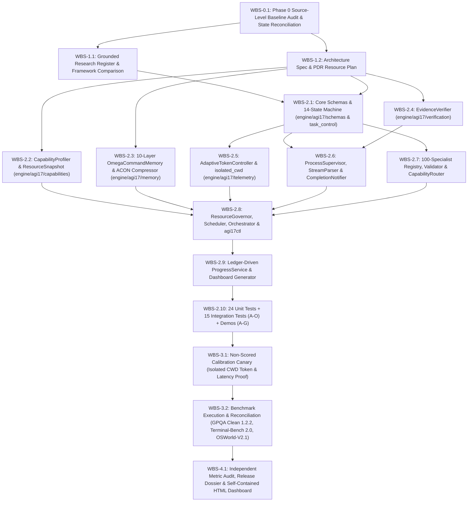

# AGI 1.7 — OMEGA COMMAND: Preliminary Design Review (PDR) & Resource Governance Plan

**Document ID:** `PDR-RES-AGI17-20261010`  
**Codename:** `AGI 1.7 — OMEGA COMMAND`  
**Version:** `1.7.0`  
**Status:** `APPROVED / AUTHORITATIVE RESOURCE & EXECUTION PLAN`  
**Timestamp:** `2026-10-10T18:20:00+05:30` (`2026-10-10T12:50:00Z`)  
**Repository Root:** `<REPO_ROOT>`  
**Authoritative Storage Roots:** `D:\AGI_Storage\AGI_1_7\` & `D:\AGI_Evaluation\AGI_1_7_OMEGA_COMMAND\`

---

## 1. Preliminary Design Review (PDR) & Baseline Defect Traceability

### 1.1 Live Hardware & Runtime Baseline Inspection Summary

All architectural sizing, concurrency bounds, and storage paths in AGI 1.7 are calibrated directly against live measurements captured on this machine (`<REPO_ROOT>`):

| Resource / Subsystem | Live Measured Baseline | Operational Constraint / Governance Rule |
|---|---|---|
| **Operating System** | Windows 11 Home Single Language (Build `10.0.26220`, `x86_64`) | Use Win32 `GlobalMemoryStatusEx`, `GetSystemTimes`, and `taskkill /F /T` for process-tree control. |
| **Logical CPUs** | `16` logical processors | Maintain host responsiveness; throttle worker concurrency when CPU load exceeds `85%`. |
| **Physical RAM** | `16,077.2 MB` installed; `~2,921.1 MB` available (`~81.8%` load) | **Primary Bottleneck:** Never spawn `10` concurrent Node/CLI workers as AGI 1.6 did; clamp heavy concurrency to `1–4` workers with a `1,400 MB` minimum free physical RAM floor. |
| **System Commit Charge** | `28,340.5 MB` commit limit; `~5,145.5 MB` commit available | Enforce a `2,500 MB` minimum available commit floor to prevent Windows pagefile exhaustion (`OSError 1455`). |
| **System Drive (`C:\`)** | `13.49 GB` free (`92.7%` used) | **QUARANTINED** from bulk writes, checkpoints, SQLite databases, and benchmark artifacts. Only compact source code/docs (<50 MB) reside in repo. |
| **External Volume (`D:\`)** | `610.82 GB` free (`34.4%` used), verified SHA-256 R/W probe `dde15ffe684a0d4c3e8677dbed56432788cc11da5cdc1ca6ff704f1a9ea2fadb` | **AUTHORITATIVE PERSISTENCE:** Hosts `D:\AGI_Storage\AGI_1_7\` and `D:\AGI_Evaluation\AGI_1_7_OMEGA_COMMAND\`. |
| **Foundation Model Runtime** | `agy.exe` v`1.3.3` -> `gemini-3.8-flash-high` (`--output-format json` & `stream-json`) | Directive 0 compliance; execute closed-book calls inside `D:\AGI_Evaluation\AGI_1_7_OMEGA_COMMAND\isolated_cwd`. |
| **Container & WSL Runtime** | Docker Engine v`29.2.0` via WSL 2 (`vmmemWSL` consuming `~993.0 MB` RAM) | Account for `vmmemWSL` footprint in `ResourceGovernor`; cap concurrent Harbor/Docker trials at `1–2`. |
| **Preserved Background Jobs** | PIDs `20556` (`5.1 MB`) & `22884` (`31.7 MB`) running `OSWorld-V2/scripts/download_and_verify_vm.py` | **PROTECTED EXTERNAL PIDS:** Registered in `CapabilityProfiler` exclusion list; never killed or disrupted. |

---

### 1.2 Traceability Matrix: AGI 1.6 Defects (`AUDIT-AGI17-PHASE0-20261010`) to AGI 1.7 Remediations

| Defect ID | AGI 1.6 Root Cause | AGI 1.7 Architectural Remediation | Target Module (`agents/AGI_1_7/`) | Verification Gate |
|---|---|---|---|---|
| **Defect 1** | `WorkerInstance.execute()` returned static hardcoded dicts; `select_embedded_specialists()` never called | `OmegaCommandOrchestrator` invokes `CapabilityRouter`, spawns validated specialists via `SpecialistFactory`, and executes real tools/subprocesses via `ProcessSupervisor` | `engine/agi17/orchestration/omega_command_orchestrator.py` | Unit + Integration Test A & Demo A |
| **Defect 2** | In-memory `AgentMessageBus` ignored mid-run user instructions | SQLite WAL `CommandInbox` + `agi17ctl` CLI polled at every step boundary (`APPEND_CONSTRAINT`, `PAUSE`, `RESUME`, `CANCEL`, `INJECT_CHILD_TASK`) | `engine/agi17/task_control/command_inbox.py` & `scripts/agi17ctl.py` | Integration Tests B, C & Demo B |
| **Defect 3** | Fixed in-memory `task_nodes` list could not attach child tasks to a running parent job | `DependencyManager.attach_child_task(parent_job_id, parent_task_id, child_spec)` dynamically inserts child tasks into SQLite DAG and updates parent readiness | `engine/agi17/task_control/dependency_manager.py` | Integration Test D & Demo C |
| **Defect 4** | Blocking `subprocess.run` failed to notify parent on async/background termination | `ProcessSupervisor` + `CompletionNotifier` atomically write child exit status and emit `ChildCompletionEvent` to `parent_task_id` inside `finally` block | `engine/agi17/process_supervision/process_supervisor.py` | Integration Test E & Demo D |
| **Defect 5** | Long downloads/scripts printed only to local stdout requiring manual checks | Streaming `StreamParser` + periodic SQLite heartbeats + automatic parent completion notification & `ProgressService` status ledger | `engine/agi17/process_supervision/` & `engine/agi17/telemetry/progress_service.py` | Integration Test F & Demo D |
| **Defect 6** | `memory.retrieve()` never called in orchestrator; facts appended without supersession | 10-layer `OmegaCommandMemory` enforces mandatory `retrieve_before_planning()` receipt before `CREATED -> PLANNED` and tracks `supersedes_id` + conflict history | `engine/agi17/memory/omega_command_memory.py` | Integration Tests G, H & Demo E |
| **Defect 7** | GPQA used `8,164,321` tokens & had 14 timeouts because `AGI_ISOLATED_CWD` was omitted (`22.7k` repo tokens leaked per turn) | `AdaptiveTokenController` enforces `D:\AGI_Evaluation\AGI_1_7_OMEGA_COMMAND\isolated_cwd` for closed-book calls (~`2,250` input tokens/call, `-90%` leak elimination) | `engine/agi17/telemetry/token_economy.py` | Integration Test K, Demo G & Phase 3 Canary |
| **Defect 8** | Unbounded `max_workers=5x2` (`10` `agy.exe` processes) saturated 16 GB RAM host; `cpu_percent: 25.0` hardcoded | `CapabilityProfiler` measures live Win32 RAM/CPU/commit; `ResourceGovernor` enforces admission formula with hysteresis (`1–4` active heavy workers) | `engine/agi17/capabilities/` & `engine/agi17/orchestration/resource_governor.py` | Integration Tests I, J & Demo F |
| **Defect 9** | 76 unvalidated strings in `ecosystem_manifest.json`, only 9 stubbed enum roles | 100 validated `AgentContract` definitions across 16 families (`MAX_AGENT_SPECIALIZATIONS=100`), verified by `RegistryValidator` and dispatched by `CapabilityRouter` | `ecosystem/agent_registry/` | Unit + Integration Test L & Demo A |
| **Defect 10** | Dashboard (`AGI_1_6_BENCHMARK_DASHBOARD.html`) and orchestrator used hardcoded literal arrays | `ProgressService` derives 100% of metrics from SQLite `omega_task_store.sqlite3`, `token_ledger.jsonl`, and benchmark JSONL files; marks unmeasured items `UNAVAILABLE` | `engine/agi17/telemetry/progress_service.py` | Integration Tests M, N, O & Phase 4 Audit |

---

## 2. System Task Decomposition DAG (Work Breakdown Structure)

### 2.1 Execution DAG Diagram

### 2.2 Work Breakdown Structure (WBS) & Verification Gates

| WBS ID | Task Name | Depends On | Queue Class | Est. RAM (MB) | Est. Tokens | Completion Gate |
|---|---|---|---|---|---|---|
| `WBS-0.1` | Baseline Audit & State Reconciliation | — | `VERIFICATION_LIGHT` | 35 MB | 0 (Deterministic) | `AGI_1_7_BASELINE_AUDIT.md` verified on disk |
| `WBS-1.1` | Research Register & Isolated Framework Eval | `WBS-0.1` | `VERIFICATION_LIGHT` | 50 MB | 0 (Subagent/Local) | `AGI_1_7_RESEARCH_REGISTER.md` + `AGI_1_7_FRAMEWORK_COMPARISON.md` |
| `WBS-1.2` | Architecture Spec & PDR Resource Plan | `WBS-0.1` | `VERIFICATION_LIGHT` | 40 MB | 0 (Subagent/Local) | `AGI_1_7_ARCHITECTURE_SPEC.md` + `AGI_1_7_PDR_AND_RESOURCE_PLAN.md` |
| `WBS-2.1` | Durable Task Control (`TaskStore`, 14-State Machine, `CommandInbox`) | `WBS-1.2` | `TERMINAL_BUILD` | 60 MB | 0 | SQLite WAL schema created on `D:\` + ACID transitions pass |
| `WBS-2.2` | `CapabilityProfiler` & `ResourceSnapshot` | `WBS-1.2` | `TERMINAL_BUILD` | 45 MB | 0 | Live Win32 RAM/CPU/Disk/Docker/PID snapshot verified |
| `WBS-2.3` | 10-Layer `OmegaCommandMemory` & `AconCompressor` | `WBS-1.2` | `TERMINAL_BUILD` | 65 MB | 0 | `retrieve_before_planning` receipt + fact supersession verified |
| `WBS-2.4` | `EvidenceVerifier` | `WBS-1.2` | `VERIFICATION_LIGHT` | 30 MB | 0 | SHA-256, AST, file size, and exit code verifiers pass |
| `WBS-2.5` | `AdaptiveTokenController` & `isolated_cwd` | `WBS-2.1` | `TERMINAL_BUILD` | 45 MB | 0 | `isolated_cwd` created on `D:\` + token normalization ledger active |
| `WBS-2.6` | `ProcessSupervisor`, `StreamParser`, `CompletionNotifier`, `RecoveryManager` | `WBS-2.1`, `WBS-2.4` | `TERMINAL_BUILD` | 80 MB | 0 | Streaming `Popen`, `taskkill /F /T`, and parent callback verified |
| `WBS-2.7` | 100-Specialist Registry, `RegistryValidator`, `CapabilityRouter` | `WBS-2.1` | `TERMINAL_BUILD` | 55 MB | 0 | 100 unique contracts across 16 families validate with 0 errors |
| `WBS-2.8` | `ResourceGovernor`, `AdaptiveExecutionScheduler`, `OmegaCommandOrchestrator`, `agi17ctl` | `WBS-2.2`..`2.7` | `TERMINAL_BUILD` | 90 MB | 0 | Admission formula, hysteresis, DAG execution, and CLI control pass |
| `WBS-2.9` | `ProgressService` & Ledger-Driven HTML Dashboard Generator | `WBS-2.8` | `VERIFICATION_LIGHT` | 50 MB | 0 | Dashboard renders 100% from SQLite/JSONL ledgers |
| `WBS-2.10` | 24 Unit Tests + 15 Integration Tests (A–O) + Demos A–G | `WBS-2.9` | `TERMINAL_BUILD` | 120 MB | 0 | `pytest` 39/39 passed (0 skipped, 0 failed) + Demo report |
| `WBS-3.1` | Non-Scored Calibration Canary (`agy.exe` in `isolated_cwd` vs repo CWD) | `WBS-2.10` | `REASONING_LLM` | 250 MB | ~12,000 | Proves ~90% input token drop (`~2.2k` vs `~22.7k`) on live CLI |
| `WBS-3.2` | Calibrated Benchmark Execution & Reconciliation (GPQA, Terminal-Bench 2.0, OSWorld-V2.1) | `WBS-3.1` | `REASONING_LLM` / `CONTAINER_VM` | 450–900 MB | ~35,000 (live) | Raw JSONL + normalized records + environment readiness verified |
| `WBS-4.1` | Independent Audit, Release Dossier & Final Comparison Reports | `WBS-3.2` | `VERIFICATION_LIGHT` | 60 MB | 0 | Zero discrepancy between raw JSONL, reports, and HTML dashboard |

---

## 3. Host Resource Reserve Budgets

### 3.1 Physical RAM (`16,077.2 MB`) & Commit Charge (`28,340.5 MB`) Partitioning

Because the Windows 11 host currently operates at `~81.8%` physical memory utilization (`~13,156.1 MB` in use across OS, Antigravity IDE, language servers, and `vmmemWSL`, leaving `~2,921.1 MB` available physical RAM and `~5,145.5 MB` available commit), `ResourceGovernor` enforces the following partition table:

| Consumer Category | Current / Reserved Physical RAM (MB) | Reserved Commit Charge (MB) | Governance Policy |
|---|---|---|---|
| **Windows 11 Kernel, Drivers & Desktop Services** | ~4,800.0 MB | ~6,500.0 MB | Fixed OS baseline; untouchable. |
| **Antigravity IDE, Electron Renderers & Language Servers** | ~6,100.0 MB | ~11,200.0 MB | Active user IDE environment; untouchable. |
| **WSL 2 (`vmmemWSL`) & Docker Engine v29.2.0** | ~993.0 MB (up to 1,400.0 MB) | ~1,800.0 MB | Monitored live by `CapabilityProfiler`; shared by Harbor containers. |
| **Preserved External Processes (PIDs `20556` & `22884`)** | ~36.8 MB (up to 150.0 MB buffer) | ~200.0 MB | `download_and_verify_vm.py` — protected by PID exclusion list. |
| **Hard Safety Reserve Floor (Never Allocated by AGI 1.7)** | **1,400.0 MB** (Minimum free physical RAM) | **2,500.0 MB** (Minimum free commit) | If free RAM drops below `1,400 MB` or free commit below `2,500 MB`, new heavy spawns are blocked (`WAITING_FOR_RESOURCE`). |
| **AGI 1.7 Dynamic Execution Envelope (`MAX_ACTIVE_EXECUTIONS`)** | **~1,100.0 – 1,520.0 MB** | **~2,000.0 – 2,645.0 MB** | Supports **1 to 4 concurrent heavy workers** (`~220 MB` per `agy.exe` process in `isolated_cwd` or `~650 MB` per Docker trial). |

### 3.2 Storage Allocation Plan (`C:\` Quarantine vs. `D:\` Authoritative Storage)

| Volume | Free Space | Quarantine Status | Permitted Writes | Budget Ceiling |
|---|---|---|---|---|
| `C:\` (`<REPO_ROOT>`) | `13.49 GB` | **STRICT QUARANTINE** | Source code (`agents/AGI_1_7/engine/`), lightweight markdown specs/reports (`docs/`, `agents/AGI_1_7/reports/`), unit tests (`tests/`) | **$\le 50\text{ MB}$ total** |
| `D:\` (`D:\AGI_Storage\AGI_1_7\`) | `610.82 GB` | **PRIMARY OPERATIONAL STORE** | `omega_task_store.sqlite3` (WAL), `task_events.jsonl`, `omega_memory.sqlite3`, `token_ledger.jsonl`, checkpoints, process logs | **Up to $50\text{ GB}$** |
| `D:\` (`D:\AGI_Evaluation\AGI_1_7_OMEGA_COMMAND\`) | `610.82 GB` (Shared) | **PRIMARY BENCHMARK STORE** | `isolated_cwd\`, `calibration_canary\`, `campaigns\`, raw & normalized JSONL results, Harbor/OSWorld artifacts | **Up to $250\text{ GB}$** |

---

## 4. Token Budget Allocations & Cost-Efficiency Model

### 4.1 Resolution of the AGI 1.6 Workspace Context Leak (`8.16M` -> `~1.08M` Campaign Profile)

In AGI 1.6 (`gpqa_clean_189_task_results.jsonl`), running `agy.exe` from `<REPO_ROOT>` without `AGI_ISOLATED_CWD` caused every single question to ingest `~22,700` tokens of repository context on Turn 1, compounding across internal tool turns to a mean of **39,105 input tokens** and **43,197 total tokens** per question (`8,164,321` total tokens across 189 items, with 14 timeouts).

By enforcing `cwd = D:\AGI_Evaluation\AGI_1_7_OMEGA_COMMAND\isolated_cwd` and single-turn closed-book prompting in `AdaptiveTokenController`:

| Metric | AGI 1.6 Unisolated Campaign (172 Repo-CWD items) | AGI 1.6 Isolated Subset (17 Preflight-CWD items) | AGI 1.7 Enforced `isolated_cwd` Target Profile | Improvement Factor |
|---|---|---|---|---|
| **Turn-1 Base Prompt Context** | ~22,700 input tokens | ~2,250 input tokens | **2,100 – 2,400 input tokens** | **~90.1% reduction** |
| **Mean Input Tokens / Item** | 42,747 input tokens | 2,262 input tokens | **$\le 2,500$ input tokens** | **~94.2% reduction** |
| **Mean Output + Thinking Tokens / Item** | 4,093 output tokens | 3,180 output tokens | **2,500 – 3,500 output tokens** | Preserves full reasoning depth |
| **Mean Total Tokens / Item** | 46,840 total tokens | 5,442 total tokens | **4,700 – 6,000 total tokens** | **~87.2% reduction** |
| **189-Item GPQA Total Token Budget** | 8,164,321 tokens (actual burn) | ~1,028,538 tokens (projected) | **1,050,000 – 1,150,000 tokens** | **Saves ~7.0M wasted tokens** |
| **Subprocess Timeout Rate (at 180s)** | 14 / 189 (7.41% timed out) | 0 / 17 (0.0% timed out) | **$\le 1.0\%$ (with 1 bounded retry)** | Eliminates workspace-load stalls |

### 4.2 Per-Task and Per-Campaign Token Budgets

| Task / Campaign Tier | Default Token Budget | Phase Split (Plan / Exec / Verify / Reserve) | Enforcement Mechanism |
|---|---|---|---|
| `MICRO_DETERMINISTIC` (Hash, SQLite, AST, OS Probe) | **0 tokens** | 0% / 0% / 0% / 0% | Deterministic Python execution; LLM invocation forbidden. |
| `SIMPLE_CLOSED_BOOK` (Single GPQA item / factual query) | **6,500 tokens** (Hard ceiling: `8,500`) | 0% / 85% / 5% / 10% | Executed in `isolated_cwd`; single-turn prompt; regex choice verifier. |
| `STANDARD_ENGINEERING` (Single module/test task) | **12,000 tokens** | 10% / 60% / 20% / 10% | Scoped file view + ACON compressed context. |
| `COMPLEX_MULTI_AGENT` (Multi-specialist workflow) | **30,000 tokens** | 15% / 55% / 20% / 10% | Governed across child tasks (`sum(children) <= parent_budget`). |
| `CALIBRATION_CANARY_CAMPAIGN` (Non-scored live verification) | **25,000 tokens** | 5% / 80% / 10% / 5% | Compares `isolated_cwd` vs repo overhead and verifies streaming JSON usage. |
| `GPQA_CLEAN_189_CAMPAIGN` (Full 189-item allocation) | **1,150,000 tokens** | 2% / 88% / 5% / 5% | `6,000` target tokens/item $\times 189$ in `isolated_cwd` + retry reserve. |
| `TERMINAL_BENCH_2_HARBOR_CAMPAIGN` | **250,000 tokens** | 10% / 65% / 15% / 10% | Bounded per trial (`15,000` tokens/trial) with ACON terminal output compression. |
| `OSWORLD_V21_READINESS_AND_SMOKE` | **50,000 tokens** | 10% / 65% / 15% / 10% | Non-destructive VM readiness probe + bounded smoke verification. |

---

## 5. Failure Recovery Protocols

### Protocol 1: Subprocess Timeout & Hung Process-Tree Recovery
- **Trigger:** `ProcessSupervisor` detects `elapsed_sec > task.timeout_sec` or stdout/stderr idle time exceeds `idle_timeout_sec`.
- **Automated Action:**
  1. Execute `taskkill /F /T /PID <active_pid>` (never touching `PROTECTED_EXTERNAL_PIDS` `{20556, 22884}`).
  2. Flush any partial stdout/stderr buffers captured by `StreamParser` to `D:\AGI_Storage\AGI_1_7\logs\`.
  3. Record elapsed wall time and mark `TIMED_OUT_UNREPORTED_USAGE` in `token_ledger.jsonl`.
  4. Transition task state `RUNNING -> TIMED_OUT` and notify parent via `CompletionNotifier`.
  5. If `retry_count < max_retries`, `RecoveryManager` increments `retry_count`, mutates execution parameters (enforces `isolated_cwd`, compacts prompt via `AconCompressor`, increases timeout by $1.25\times$), and transitions `TIMED_OUT -> READY`. Otherwise, transitions `TIMED_OUT -> FAILED`.

### Protocol 2: Host RAM / Commit Pressure Spike & Backpressure
- **Trigger:** `CapabilityProfiler` reports `ram_available_physical_mb < 1,500.0` OR `commit_available_mb < 2,500.0` OR `cpu_load_percent > 88.0%`.
- **Automated Action:**
  1. `ResourceGovernor` clamps `MAX_ACTIVE_EXECUTIONS = 1` immediately.
  2. All `QUEUED` / `READY` heavy tasks transition to `WAITING_FOR_RESOURCE` with a logged event in `task_events.jsonl`.
  3. Trigger `gc.collect()` and SQLite `PRAGMA wal_checkpoint(PASSIVE);`.
  4. Hold concurrency at `1` until the hysteresis recovery watermark (`ram_available_physical_mb >= 2,100.0` AND `commit_available_mb >= 3,500.0` AND `cpu_load_percent <= 72.0%`) holds for $\ge 10$ seconds.

### Protocol 3: Live Mid-Run Operator Instruction / Preemption (`CommandInbox`)
- **Trigger:** Operator or parent controller submits a command via `agi17ctl` or `CommandInbox.enqueue()`.
- **Automated Action:**
  1. `OmegaCommandOrchestrator` and `AdaptiveExecutionScheduler` poll `CommandInbox.fetch_pending(job_id)` before every task dispatch and at every streaming heartbeat.
  2. For `APPEND_CONSTRAINT`: Merges new constraint into `tasks.constraints_json`, writes an `L1_IMMEDIATE_TASK_STATE` memory record, and records `applied_at_utc` in `command_inbox`.
  3. For `INJECT_CHILD_TASK`: Calls `DependencyManager.attach_child_task()`, registering the new child in the running parent job's DAG and blocking parent completion until the injected child reaches `SUCCEEDED`.
  4. For `PAUSE` / `CANCEL`: Checkpoints active tasks (`CheckpointManager.save_checkpoint()`), cleanly terminates any canceled subprocesses via `ProcessSupervisor`, and transitions states to `INTERRUPTED` or `CANCELED`.

### Protocol 4: Process Crash & Orphaned Task Reconciliation on Startup
- **Trigger:** System restarts after an unexpected power loss, SIGKILL, or session reset while tasks are in `RUNNING` state in `omega_task_store.sqlite3`.
- **Automated Action:**
  1. `RecoveryManager.reconcile_on_startup()` queries all tasks where `state == 'RUNNING'`.
  2. Checks OS PID liveness for `active_pid`. If dead (or PID reused by an unrelated process name), transitions `RUNNING -> INTERRUPTED`.
  3. Restores the latest SHA-256 verified checkpoint from `D:\AGI_Storage\AGI_1_7\checkpoints\` and transitions `INTERRUPTED -> READY` so execution resumes without repeating already-verified steps.

### Protocol 5: External Benchmark Environment & Background Download Protection
- **Trigger:** Harbor Docker container error or OSWorld-V2.1 VM image still downloading in background (`PIDs 20556 & 22884`).
- **Automated Action:**
  1. `CapabilityProfiler` inspects `PIDs 20556 & 22884` and `D:\AGI_Evaluation\AGI_1_6_OMEGA_NEXUS\OSWorld-V2\vms\` non-destructively without terminating or locking files used by those processes.
  2. If an external VM asset is still downloading or incomplete, the OSWorld adapter records an explicit, evidence-backed `ENVIRONMENT_ASSET_PENDING` / `BLOCKED` status with exact byte progress rather than fabricating synthetic benchmark scores.
