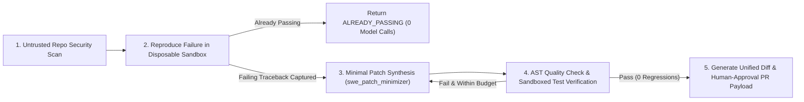

# Product Specification: AGI 1.7 Automated Python CI-Repair & Test-Healing Agent

**Product Module:** `agents.AGI_1_7.engine.agi17.orchestration.ci_repair_agent.CIRepairAgent`  
**CLI Flag:** `python agents/AGI_1_7/run_agi_17.py --ci-repair-dir <workspace_dir> --module-filename <module.py>`  
**Target Customer / Use Case:** Software engineering teams and Python repository maintainers who want automated, sandboxed root-cause diagnosis and minimal patch generation for failing `unittest` suites in CI/CD pipelines.

---

## 1. Product Scope & Workflow

Rather than claiming unconstrained "general autonomy," the **AGI 1.7 Python CI-Repair Agent** delivers a narrow, high-reliability, end-to-end engineering workflow with verifiable security and budget guarantees:

1. **Untrusted Content & Prompt-Injection Pre-Scan (`scan_untrusted_content`)**:
   - Scans workspace `.py` files before execution to detect prompt-injection instructions (`IGNORE PREVIOUS INSTRUCTIONS`, `--dangerously-skip-permissions`) and host-attack patterns (credential exfiltration, unauthorized socket/HTTP calls, destructive root deletions).
2. **Sandboxed Failure Reproduction (`DisposableSandboxRunner`)**:
   - Executes the existing test suite inside a disposable Docker container (`--rm --network none --cap-drop ALL --security-opt no-new-privileges --read-only --tmpfs /tmp:rw,exec,nosuid,size=64m --cpus 1.0 --memory 256m --pids-limit 64`) or an ephemeral restricted tempdir with stripped environment variables.
   - If all tests already pass, halts immediately (`status="ALREADY_PASSING"`, `0` tokens spent).
3. **Minimal Root-Cause Patch Synthesis (`swe_patch_minimizer` + Ponytail Railings)**:
   - Routes the failing traceback, module source, and test suite to `swe_patch_minimizer` (`gemini-3.8-flash-high`, `effort=high`) with Ponytail minimal-diff constraints.
4. **AST Quality Gate & Sandboxed Re-Verification**:
   - Validates syntax (`ast.parse`) and bare-exception checks, then re-runs the entire test suite inside a fresh disposable container to verify that all failing tests pass and zero existing tests regress.
5. **Reviewable Patch & Pull Request Payload (`requires_human_approval=True`)**:
   - Emits a standard unified diff (`a/<module.py>` $\rightarrow$ `b/<module.py>`), SHA-256 before/after digests, token/cost telemetry, and a structured PR payload. Automatic `git push` is blocked by `HighImpactApprovalGate` until approved by a human reviewer.

---

## 2. Hard Budget & Safety Boundaries

| Boundary | Default Limit | Enforcement Mechanism |
| :--- | :--- | :--- |
| **Max Repair Attempts** | `2` attempts | `CIRepairBudget.max_repair_attempts` |
| **Max Token Budget** | `80,000` tokens | `CIRepairBudget.max_tokens` + `AdaptiveTokenController` |
| **Max Cost Ceiling** | `\$0.25` USD per repair | `CIRepairBudget.max_cost_usd` + `ModelProviderConfig` (`ModelCostBudgetExceededError`) |
| **Sandbox Network Access** | Disabled (`--network none`) | `SandboxPolicy.network_enabled = False` |
| **Sandbox Filesystem** | Read-only root (`--read-only`) + ephemeral `/tmp` | `DisposableSandboxRunner` (`finally:` destruction) |
| **Host Auto-Push** | Blocked (`requires_human_approval = True`) | `HighImpactApprovalGate` (`HighImpactActionBlockedError`) |

---

## 3. Supported Inputs & Explicit Non-Goals

- **Supported:** Python 3.10+ modules and `unittest`-compatible test suites (`test_*.py`) using the Python Standard Library or pre-installed container environment packages.
- **Explicit Non-Goals (Out of Scope without Human Approval):**
  - Arbitrary `pip install` of untrusted third-party packages from the internet during sandbox runs.
  - Unsupervised `git push` to protected branches (`main`/`master`).
  - Modifying test assertions to hide bugs in the target module (tests are mounted read-only from the original workspace snapshot during candidate patch verification).
